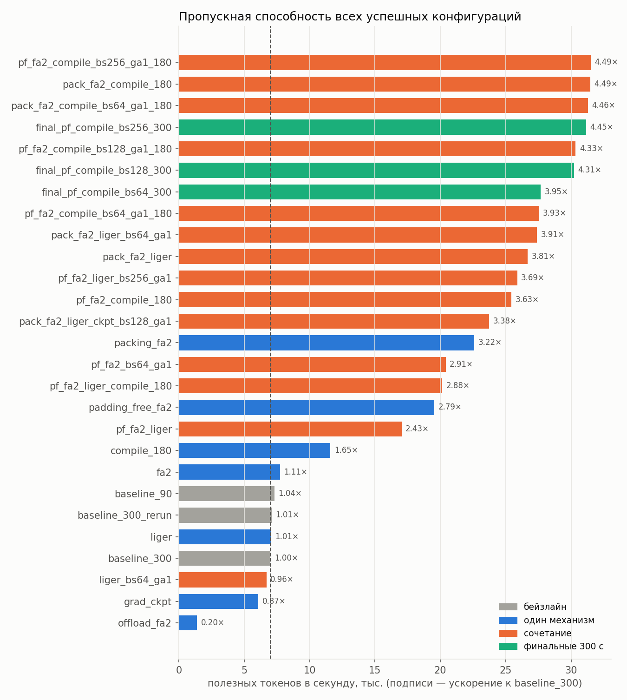
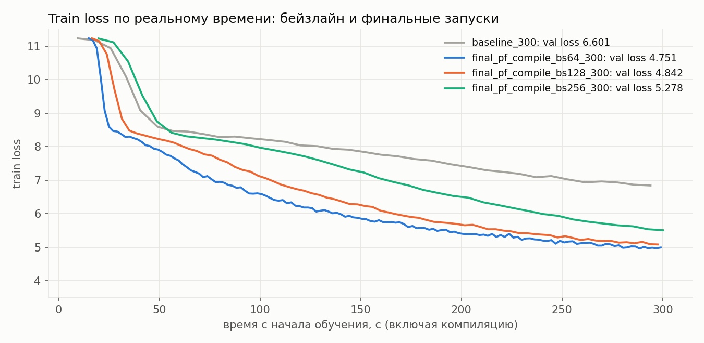

# HW2: ускорение обучения Qwen3 (~1B) на одной A100

Задача - увеличить число полезных токенов в секунду (`tokens_per_second` из `summary.json`), которое
обрабатывает `train.py` при обучении Qwen3 с нуля. Проведено 32 запуска, из них 29 успешных: исходный бейзлайн,
8 отдельных механизмов оптимизации, их сочетания и финальные 300-секундные запуски.

## Итог

| Запуск (300 с) | tok/s | **S** | Пик, ГиБ | val loss | Шагов |
|---|---|---|---|---|---|
| Бейзлайн: исходный `train.py` | 7 008 | 1.00 | 41.2 | 6.601 | 368 |
| **Итоговый `train.py`**: padding-free + FlashAttention 2 + `torch.compile`, bs 256 × ga 1 | **31 153** | **4.45** | 37.4 | 5.278 | 390 |
| Тот же итоговый `train.py`, повторный запуск без аргументов | 31 112 | 4.44 | 37.4 | 5.288 | 390 |
| padding-free + FA2 + compile, bs 128 × ga 1 | 30 232 | 4.31 | 22.6 | 4.842 | 757 |
| padding-free + FA2 + compile, bs 64 × ga 1 (тот же батч, что у бейзлайна) | 27 662 | 3.95 | 14.7 | **4.751** | 1385 |

Ускорение S = 31 153 / 7 008 = 4.45.

Итоговый `train.py` отличается от исходного пятью параметрами: `ATTENTION_IMPLEMENTATION="flash_attention_2"`,
`padding_free=True`, `torch_compile=True`, `per_device_train_batch_size=256`, `gradient_accumulation_steps=1`.
Параметры обучения (lr, warmup, оптимизатор, `max_length`, данные) не менялись.

## Сетап

- **Модель:** Qwen3 из задания (12 слоёв, hidden 2048, 16 голов, 8 KV-голов, FFN 8192), ~961M параметров, bf16.
- **Данные:** абзацы из первых 50 500 статей русской Википедии: 244 768 train-абзацев (22.3M токенов), валидационный loss считается на 512 абзацах. Длина абзаца - от 32 до 512 токенов, **в среднем 91**,
  медиана 73, 90-й перцентиль 167.
- **Метрика:** `tokens_per_second` - токены с `labels != -100` (без паддинга) в секунду, без первых 10 шагов оптимизатора (туда же попадает компиляция).

Главное свойство этих данных: абзацы короткие и разной длины. Исходный коллатор дополняет батч паддингом до самого длинного абзаца, и в случайном батче из 32 абзацев полезных токенов только 35%, остальные 65% вычислений модель тратит на паддинг.

## Результаты

| Эксперимент | Что включено | Длит., с | tok/s | S | Пик, ГиБ | val loss | Шагов |
|---|---|---|---|---|---|---|---|
| `baseline_300` | исходный конфиг (SDPA, bs 32 × ga 2) | 300 | 7 008 | 1.00 | 41.2 | 6.601 | 368 |
| `baseline_90` | исходный конфиг (SDPA, bs 32 × ga 2) | 90 | 7 322 | 1.04 | 41.2 | 8.130 | 114 |
| `grad_ckpt` | act. checkpointing, bs 32 × ga 2 | 91 | 6 085 | 0.87 | 17.4 | 8.217 | 95 |
| `fa2` | FA2, bs 32 × ga 2 | 90 | 7 749 | 1.11 | 39.3 | 8.096 | 121 |
| `padding_free_fa2` | FA2, padding-free, bs 32 × ga 2 | 90 | 19 549 | 2.79 | 15.1 | 6.854 | 309 |
| `packing_fa2` | FA2, packing, bs 32 × ga 2 | 91 | 22 587 | 3.22 | 40.2 | 8.211 | 64 |
| `compile` | compile, bs 32 × ga 2 | 90 | n/a | n/a | 26.0 | 11.235 | 2 |
| `liger` | Liger, bs 32 × ga 2 | 91 | 7 050 | 1.01 | 26.8 | 8.159 | 106 |
| `offload_fa2` | FA2, act. offloading, bs 32 × ga 2 | 94 | 1 393 | 0.20 | 16.4 | 11.090 | 20 |
| `liger_bs64_ga1` | Liger, bs 64 × ga 1 | 90 | 6 702 | 0.96 | 43.9 | 8.163 | 104 |
| `pf_fa2_bs64_ga1` | FA2, padding-free, bs 64 × ga 1 | 90 | 20 406 | 2.91 | 20.1 | 6.815 | 323 |
| `pf_fa2_liger` | FA2, padding-free, Liger, bs 32 × ga 2 | 90 | 17 035 | 2.43 | 12.3 | 7.115 | 262 |
| `pf_fa2_liger_bs256_ga1` | FA2, padding-free, Liger, bs 256 × ga 1 | 90 | 25 880 | 3.69 | 34.4 | 7.993 | 101 |
| `pack_fa2_liger` | FA2, packing, Liger, bs 32 × ga 2 | 91 | 26 678 | 3.81 | 25.8 | 8.142 | 75 |
| `pack_fa2_liger_bs64_ga1` | FA2, packing, Liger, bs 64 × ga 1 | 90 | 27 387 | 3.91 | 41.9 | 8.137 | 76 |
| `pack_fa2_liger_ckpt_bs128_ga1` | FA2, packing, Liger, act. checkpointing, bs 128 × ga 1 | 90 | 23 722 | 3.38 | 15.5 | 9.382 | 33 |
| `compile_180` | compile, bs 32 × ga 2 | 180 | 11 587 | 1.65 | 31.2 | 8.217 | 95 |
| `pf_fa2_compile_180` | FA2, padding-free, compile, bs 32 × ga 2 | 180 | 25 433 | 3.63 | 12.2 | 5.780 | 607 |
| `pf_fa2_liger_compile_180` | FA2, padding-free, Liger, compile, bs 32 × ga 2 | 180 | 20 151 | 2.88 | 15.3 | 7.472 | 215 |
| `pf_fa2_compile_bs64_ga1_180` | FA2, padding-free, compile, bs 64 × ga 1 | 180 | 27 548 | 3.93 | 14.7 | 5.515 | 722 |
| `pf_fa2_compile_bs128_ga1_180` | FA2, padding-free, compile, bs 128 × ga 1 | 180 | 30 346 | 4.33 | 22.3 | 5.855 | 394 |
| `pf_fa2_compile_bs256_ga1_180` | FA2, padding-free, compile, bs 256 × ga 1 | 180 | 31 498 | 4.49 | 37.1 | 6.843 | 202 |
| `pack_fa2_compile_180` | FA2, packing, compile, bs 32 × ga 2 | 180 | 31 451 | 4.49 | 27.4 | 7.561 | 151 |
| `pack_fa2_compile_bs64_ga1_180` | FA2, packing, compile, bs 64 × ga 1 | 180 | 31 289 | 4.46 | 45.6 | 7.642 | 144 |
| `final_pf_compile_bs256_300` | FA2, padding-free, compile, bs 256 × ga 1 | 300 | 31 153 | 4.45 | 37.4 | 5.278 | 390 |
| `final_pf_compile_bs128_300` | FA2, padding-free, compile, bs 128 × ga 1 | 300 | 30 232 | 4.31 | 22.6 | 4.842 | 757 |
| `final_pf_compile_bs64_300` | FA2, padding-free, compile, bs 64 × ga 1 | 300 | 27 662 | 3.95 | 14.7 | 4.751 | 1385 |
| `baseline_300_rerun` | исходный конфиг (SDPA, bs 32 × ga 2) | 300 | 7 090 | 1.01 | 41.2 | 6.578 | 372 |
| `final_check_300` | итоговый `train.py` без изменений (bs 256 × ga 1) | 300 | 31 112 | 4.44 | 37.4 | 5.288 | 390 |

Не завершились:
- `bs64_ga1` (bs 64 × ga 1): `torch.OutOfMemoryError` - батч 64 с паддингом не помещается в 80 ГБ.
- `offload` (act. offloading, SDPA): `RuntimeError: attn_bias is not correctly aligned (strideH)`.
- `pack_fa2_liger_compile_180` (FA2, packing, Liger, compile): loss стал NaN на 10-м шаге.

`summary.json` каждого успешного запуска - в `results/<эксперимент>/summary.json`, полный вывод - в
`results/<эксперимент>.log`.

## Графики





Второй график - train loss от реального времени обучения. Все финальные конфигурации учат модель быстрее
бейзлайна и за те же 5 минут доходят до заметно меньшего val loss (4.75–5.28 против 6.60).

## Анализ экспериментов

**1. Почти всё время уходило на паддинг.** В обычном батче две трети токенов - пустые. FA2 сам по себе почти ничего не дал (+6%), а padding-free без паддинга ускорил обучение в 2.7 раза на тех же батчах.

**2. `torch.compile` даёт ещё +30% поверх padding-free.** Формы тензоров меняются каждый шаг в обоих режимах: с паддингом батч дополняется до самого длинного абзаца в нём, без паддинга меняется длина склеенной последовательности. Но с паддингом компиляция шла больше двух минут, а без него - 46 секунд.

**3. Лучшее сочетание - padding-free, compile и большой микробатч.** Без паддинга в микробатче всего ~2.9 тыс. токенов, и GPU простаивает. С батчем в 256 абзацев скорость дошла до ~31.5 тыс. tok/s -
это потолок карты, packing упирается в него же.

**4. Liger больше влияет на память, чем на скорость.** Он снижает пик с 41 до 27 ГиБ. На маленьких батчах
замедляет на 13%, на больших с packing ускоряет на 18%.

**5. Checkpointing и offloading не нужны.** Оба экономят память ценой скорости: checkpointing медленнее на 17%, offloading - в 5.6 раза. При 80 ГБ на модель в 1B памяти и так хватает.

**6. Больше токенов в секунду не всегда приводит к лучшему качеству.** С батчем 256 модель делает меньше шагов и за 5 минут доходит до val loss 5.28, а с батчем 64 - до 4.75. Итоговым выбран батч 256 ради S, но если важнее качество, лучше вариант с 64 (S = 3.95).

## Коммуникации

[`communications.ipynb`](communications.ipynb) реализует три кольцевые операции на CPU с Gloo:

- **`ring_reduce_scatter`:** тензор делится на `world_size` кусков. За `world_size − 1` шагов каждый процесс отправляет правому соседу кусок `(rank − step − 1) mod world_size` и прибавляет полученный от левого соседа кусок `(rank − step − 2) mod world_size`. После последнего шага у процесса `rank` полностью просуммирован кусок `rank` - как у `dist.reduce_scatter_tensor`.
- **`ring_all_gather`:** тот же обход кольца, но полученный кусок не суммируется, а кладётся на своё место; через `world_size − 1` шагов у каждого процесса есть все куски.
- **`ring_all_reduce`:** reduce-scatter, затем all-gather. Каждый процесс отправляет и принимает `2 · (world_size − 1) / world_size` от размера тензора.

Обмен идёт через неблокирующие `dist.isend` / `dist.irecv`, поэтому соседи не блокируют друг друга. Входной тензор не меняется: reduce-scatter работает с копиями кусков. Проверки из ноутбука (сравнение с `dist.reduce_scatter_tensor`, `dist.all_gather`, `dist.all_reduce` на размерах кусков 1, 7, 31 и проверка неизменности входа):

```text
OK: все три операции прошли проверки на 2 процессах.
OK: все три операции прошли проверки на 4 процессах.
```

## Как воспроизвести

```bash
# итоговая конфигурация (300 с, results/final_pf_compile_bs256_300)
python train.py

# все эксперименты на 4 GPU; при первом запуске готовит данные
GPUS=0,1,2,3 python experiments.py

# таблица и графики по results/*/summary.json
python make_report.py

# коммуникации
jupyter nbconvert --to notebook --execute communications.ipynb --inplace
```
