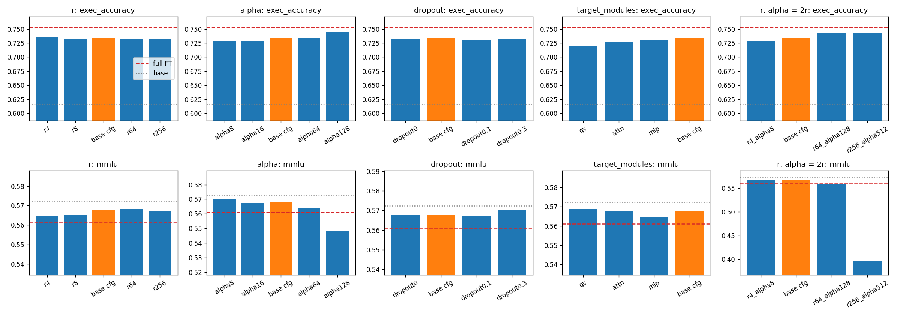

# Full fine-tuning vs LoRA на Qwen2.5-1.5B-Instruct

Модель `Qwen/Qwen2.5-1.5B-Instruct` дообучена на задаче text-to-SQL двумя способами: полным fine-tuning и LoRA.
Затем проведён перебор гиперпараметров LoRA (r, alpha, dropout, target_modules). Всего 21 запуск, каждый на одной H200.

## Окружение

- **GPU:** NVIDIA H200 141 GB. Под с 4 картами, каждый запуск занимает одну карту целиком, четыре запуска идут параллельно, без распределённого обучения.
- **Библиотеки:** torch 2.6, transformers 4.56.2, trl 0.23.1, peft 0.17.1, datasets 3.6.0, flash-attn 2.7.3.

## 1. Датасет

Выбран вариант А: [`gretelai/synthetic_text_to_sql`](https://huggingface.co/datasets/gretelai/synthetic_text_to_sql) (Apache 2.0, ревизия `740ab236`). В нём 105 851 пример - 100 000 в train и 5 851 в test. Каждый пример содержит схему базы с данными (`CREATE TABLE` и `INSERT`), вопрос на английском, эталонный SQL, класс сложности и домен. Всего 100 доменов, сложность от простого `SELECT` до оконных функций и CTE.

Почему этот датасет:
- Он большой и разнообразный, так что модель не может просто запомнить ответы.
- У исходной модели есть запас роста, она решает 62% тестовых примеров. Различия между способами дообучения на таком уровне хорошо видны.
- Качество проверяется объективно. К вопросу приложена база с данными, поэтому запрос модели можно выполнить и сравнить результат с эталоном, а не сравнивать текст.
- Примеры короткие (медиана 171 токен вместе с ответом). Эпоха на 76k примерах занимает около 10 минут, поэтому удалось прогнать 20 конфигураций.

**Подготовка** (`prepare_data` в `run.py`). В датасете смешаны диалекты SQL, поэтому оставлены только примеры, где схема и эталонный запрос выполняются в SQLite. Так train сократился со 100 000 до 76 172 примеров. В test дополнительно оставлены только `SELECT`-запросы с непустым результатом, пустой результат совпал бы и у многих неверных запросов. Так test сократился с 5 851 до 3 177 примеров. Сплиты взяты из самого датасета, все модели обучаются и оцениваются на одних и тех же данных.

Примеры из train:

| сложность | вопрос | схема | SQL |
|---|---|---|---|
| basic SQL | How many marine species are found in the Southern Ocean? | `CREATE TABLE marine_species (name VARCHAR(50), common_name VARCHAR(50), location VARCHAR(50));` | `SELECT COUNT(*) FROM marine_species WHERE location = 'Southern Ocean';` |
| aggregation | List all the unique equipment types and their corresponding total maintenance frequency from the equipment_maintenance table. | `CREATE TABLE equipment_maintenance (equipment_type VARCHAR(255), maintenance_frequency INT);` | `SELECT equipment_type, SUM(maintenance_frequency) AS total_maintenance_frequency FROM equipment_maintenance GROUP BY equipment_type;` |
| single join | What is the total value of artworks for each artist in the 'artists_valuation' table? | `CREATE TABLE artist (id INT, name VARCHAR(50)); INSERT INTO artist (id, name) VALUES (1, 'Picasso'), (2, 'Warhol'), (3, 'Basquiat'); CREATE TABLE artists_valuation (artist_id INT, valuation INT); INSERT INTO ...` | `SELECT a.name, SUM(av.valuation) AS total_valuation FROM artist a JOIN artists_valuation av ON a.id = av.artist_id GROUP BY a.id, a.name;` |

Распределение по сложности в test: basic SQL 1670, aggregation 755, single join 417, subqueries 139, window functions 116, multiple_joins 54, set operations 26.

Формат диалога: в системном промпте инструкция «You are an SQL expert... reply with one SQLite query», в user промпте схема и вопрос, в ответе assistant эталонный SQL. Loss считается только по ответу.

## 2. Метрики

1. **Execution accuracy** на 3 177 тестовых примерах (метрика задачи). Модель генерирует ответ жадно; если запрос обёрнут в блок `` ```sql ``, он извлекается. Затем запрос модели и эталонный запрос выполняются в SQLite на одной и той же базе, и результаты сравниваются как мультимножества строк (дробные числа округляются до 4 знаков). Ошибка выполнения считается неверным ответом. В отличие от exact match, эта метрика не штрафует за другие алиасы, другой порядок `JOIN` и прочие эквивалентные формулировки.
2. **MMLU** (`cais/mmlu`, all, 14 042 вопроса, 0-shot): общие знания. Вопрос с вариантами подаётся через chat template, ответом считается буква с наибольшим логитом среди A/B/C/D. Метрика показывает, сколько общих знаний модель теряет при дообучении на SQL.

## 3. Конфигурации обучения

Общие параметры для всех запусков: 1 эпоха (2 381 шаг), batch 32, padding-free с FlashAttention 2, max_length 1024, cosine-расписание с warmup 3%, bf16 autocast, без gradient checkpointing, seed 42.

| | Full FT | LoRA (базовый конфиг) |
|---|---|---|
| обучаемые веса | все, хранятся в fp32 | адаптеры в fp32, базовая модель в bf16 заморожена |
| learning rate | 1e-5 | 2e-4 |
| r / alpha / dropout | - | 16 / 32 / 0.05 |
| target_modules | - | все линейные слои: q, k, v, o, gate, up, down |

Перебор LoRA: параметры меняются по одному, остальное как в базовом конфиге.
- r $\in$ {4, 8, 16, 64, 256} при alpha = 32;
- alpha $\in$ {8, 16, 32, 64, 128} при r = 16;
- dropout $\in$ {0, 0.05, 0.1, 0.3};
- target_modules $\in$ {q+v, attention (q, k, v, o), MLP (gate, up, down), все};
- комбинации r $\in$ {4, 64, 256} с alpha = 2r, чтобы отделить влияние ранга от масштаба alpha/r;
- повтор базового конфига с seed 1, чтобы оценить шум.

## 4. Результаты

| запуск | r | alpha | dropout | target_modules | обучаемые параметры | обучение, мин | пик памяти, GiB | exec acc | MMLU |
|---|---|---|---|---|---|---|---|---|---|
| исходная модель | - | - | - | - | - | - | - | 0.617 | 0.572 |
| **Full FT** | - | - | - | - | 1544M (100%) | 9.3 | 54.0 | **0.753** | 0.561 |
| **LoRA** | 16 | 32 | 0.05 | все | 18.5M (1.20%) | 9.9 | 38.6 | 0.734 | 0.568 |
| LoRA, seed 1 | 16 | 32 | 0.05 | все | 18.5M (1.20%) | 9.9 | 39.7 | 0.731 | 0.572 |
| r4 | 4 | 32 | 0.05 | все | 4.6M (0.30%) | 10.1 | 38.3 | 0.735 | 0.564 |
| r8 | 8 | 32 | 0.05 | все | 9.2M (0.60%) | 9.9 | 38.4 | 0.733 | 0.565 |
| r64 | 64 | 32 | 0.05 | все | 73.9M (4.78%) | 9.9 | 39.5 | 0.733 | 0.568 |
| r256 | 256 | 32 | 0.05 | все | 295.4M (19.1%) | 10.4 | 42.9 | 0.732 | 0.567 |
| alpha8 | 16 | 8 | 0.05 | все | 18.5M | 9.9 | 38.6 | 0.729 | 0.570 |
| alpha16 | 16 | 16 | 0.05 | все | 18.5M | 9.8 | 38.6 | 0.729 | 0.568 |
| alpha64 | 16 | 64 | 0.05 | все | 18.5M | 9.9 | 38.6 | 0.735 | 0.564 |
| alpha128 | 16 | 128 | 0.05 | все | 18.5M | 9.9 | 38.6 | 0.745 | 0.548 |
| dropout0 | 16 | 32 | 0 | все | 18.5M | 9.2 | 35.2 | 0.732 | 0.568 |
| dropout0.1 | 16 | 32 | 0.1 | все | 18.5M | 9.9 | 38.6 | 0.731 | 0.567 |
| dropout0.3 | 16 | 32 | 0.3 | все | 18.5M | 9.8 | 38.6 | 0.732 | 0.570 |
| q+v | 16 | 32 | 0.05 | q, v | 2.2M (0.14%) | 6.6 | 30.0 | 0.720 | 0.569 |
| attention | 16 | 32 | 0.05 | q, k, v, o | 4.4M (0.28%) | 7.3 | 31.7 | 0.726 | 0.568 |
| MLP | 16 | 32 | 0.05 | gate, up, down | 14.1M (0.91%) | 8.4 | 35.0 | 0.730 | 0.565 |
| r4, alpha 8 | 4 | 8 | 0.05 | все | 4.6M | 10.2 | 38.3 | 0.729 | 0.568 |
| r64, alpha 128 | 64 | 128 | 0.05 | все | 73.9M | 9.9 | 39.5 | 0.743 | 0.560 |
| r256, alpha 512 | 256 | 512 | 0.05 | все | 295.4M | 10.3 | 42.9 | 0.743 | **0.397** |



Красный пунктир на графиках - Full FT, серая точечная линия - исходная модель, оранжевый столбец - базовый конфиг LoRA. Полная таблица и парные сравнения лежат в [`results/table.md`](results/table.md), каждый запуск - в `results/<запуск>/summary.json`.

У базового конфига LoRA с seed 42 и seed 1 execution accuracy отличается на 0.3 п.п., MMLU - на 0.4 п.п. Различия такого размера - шум. Чтобы проверить разницу между Full FT и LoRA, на одних и тех же тестовых примерах посчитаны случаи, где права только одна из моделей. Только Full FT права в 132 примерах, только LoRA - в 72, z = 4.2, то есть разница реальная. Между двумя seed это 83 против 74, z = 0.7.

Точность по классам сложности:

| | aggregation | basic SQL | multiple_joins | set operations | single join | subqueries | window functions |
|---|---|---|---|---|---|---|---|
| исходная | 0.445 | 0.775 | 0.370 | 0.154 | 0.559 | 0.396 | 0.138 |
| Full FT | 0.697 | 0.850 | 0.537 | 0.308 | 0.727 | 0.554 | 0.259 |
| LoRA | 0.642 | 0.845 | 0.574 | 0.346 | 0.717 | 0.496 | 0.241 |

Исходная модель в 298 ответах из 3 177 оборачивает SQL в markdown (это учтено при извлечении), 196 её запросов падают с ошибкой, ещё 1 022 выполняются, но дают не тот результат. После дообучения markdown исчезает полностью. Ошибок выполнения становится 31 у Full FT и 51 у LoRA, неверных результатов - 754 и 794. Основной прирост идёт не от синтаксиса, а от того, что модель перенимает соглашения датасета: какие столбцы возвращать, когда группировать и как агрегировать. Больше всего выросла aggregation (+25 п.п. у Full FT), остальные сложные классы выросли на 12-17 п.п.

## 5. Ручная оценка

Семь тестовых примеров, первый пример каждого класса сложности, и два общих запроса без SQL. Ответы трёх моделей лежат
в `results/{base,full,lora}/summary.json`, поле `manual`.

| пример | исходная | Full FT | LoRA |
|---|---|---|---|
| basic SQL #1: средний explainability score для Europe и North America | верно | верно | верно |
| aggregation #3: сколько аварий у SpaceX и Blue Origin | неверно: `COUNT(*) ... IN (...)` | неверно, то же | неверно, то же |
| single join #19: суммарный вес груза 'Fruit' по портам | неверно: алиас `C.Weight` при алиасе таблицы `CH`, запрос падает | верно | верно |
| multiple_joins #25: сумма пожертвований по программам | верно | верно | верно |
| subqueries #44: женщины на кафедре физики без грантов | верно | верно | верно |
| set operations #251: проекты Европы и Океании по типам | неверно: группирует только по региону, в markdown | неверно: лишний self-join | неверно: лишний cross join со списком регионов |
| window functions #18: максимальная дневная инвестиция по клиентам | неверно: `GROUP BY` | неверно: `GROUP BY` | неверно: `GROUP BY` |
| «Explain in two sentences why the sky is blue» | 2 предложения, верно | 2 предложения, верно, называет рэлеевское рассеяние | 2 предложения, верно, называет рэлеевское рассеяние |
| «Напиши короткое поздравление с днём рождения для коллеги» | длинный шаблон с `[имя]` и пояснением, есть грамматические ошибки | короткое, грамотное | короткое, грамотное |

Наблюдения:
- **В датасете присутствуют ошибки.** В #3 все три модели честно отвечают одним числом на вопрос «сколько», а эталон группирует по провайдерам. В #18 модели считают максимум через `GROUP BY`, как и просит вопрос, а эталон возвращает оконную функцию по каждой строке. Потолок execution accuracy на этом датасете заметно ниже 100%.
- **Дообучение чинит конкретные промахи.** В #19 обе дообученные модели правильно используют алиасы.
- **Set operations не выучились.** в train таких примеров всего 774. Ни одна модель не собрала ответ из двух выборок через `UNION ALL`, как в эталоне.
- **Общие навыки на этих запросах сохранились у обеих моделей.** Поздравление стало короче и грамотнее, видимо из-за коротких ответов в обучении. У Full FT и LoRA ответы почти одинаковые.

## 6. Full FT и LoRA: ресурсы

| | Full FT | LoRA (r=16, все слои) | LoRA (q+v) |
|---|---|---|---|
| обучаемые параметры | 1 544M | 18.5M (в 84 раза меньше) | 2.2M |
| время эпохи | 9.3 мин | 9.9 мин | 6.6 мин |
| пик памяти GPU | 54.0 GiB | 38.6 GiB (-29%) | 30.0 GiB |
| размер сохранённых весов | 2.9 GiB (bf16) | 71 MiB (адаптер в fp32) | 8.4 MiB |

- **Память.** Full FT хранит fp32-веса, градиенты и два момента AdamW - это 16 байт на параметр, около 23 GiB. LoRA хранит bf16-веса базовой модели (3 GiB) и крошечные состояния адаптеров. Экономия около 15 GiB, а не в разы, при batch 32 без gradient checkpointing основную часть памяти занимают активации (около 30 GiB), и они нужны обоим методам.
- **Время.** LoRA не быстрее. Backward всё равно проходит через всю модель, LoRA экономит только вычисление градиентов весов и шаг оптимизатора. Зато добавляет 196 маленьких адаптеров с dropout, а на модели в 1.5B на H200 эти мелкие операции съедают всю экономию. Быстрее становится только при меньшем числе адаптируемых слоёв.

## 7. Влияние параметров LoRA

- **r почти не влияет.** При alpha = 32 execution accuracy для r от 4 до 256 лежит в пределах 0.732-0.735, MMLU - в пределах 0.564-0.568, всё внутри шума. Кривые train loss для r = 4, 16 и 256 совпадают почти точно ([plots/train_loss.png](plots/train_loss.png)). Причина в масштабировании: обновление весов равно (alpha/r) * BA. С Adam каждая из r компонент сдвигается примерно на одинаковую величину, поэтому при фиксированном alpha рост r компенсируется множителем 1/r. Получается, что для этой задачи хватает ранга 4, в 64 раза меньше параметров, чем при r = 256, при том же качестве. Больший ранг только добавляет память (+4.3 GiB у r = 256).
- **alpha работает как learning rate адаптера и задаёт баланс между задачей и забыванием.** С ростом alpha от 8 до 128 execution accuracy растёт с 0.729 до 0.745 и почти догоняет Full FT, а MMLU падает с 0.570 до 0.548, то есть ниже, чем после Full FT. Комбинации с alpha = 2r подтверждают, что важен масштаб, а не ранг. При r = 64 и alpha = 128 получается 0.743 и 0.560, как у alpha128. При r = 256 и alpha = 512 эффективный шаг становится слишком большим: SQL по-прежнему 0.743, но MMLU обваливается до 0.397, а в ответе про небо модель игнорирует просьбу уложиться в два предложения. По метрике задачи такую поломку не видно, её показывает только вторая метрика.
- **dropout не влияет на качество.** Все значения от 0 до 0.3 дают 0.731-0.734. Обучение идёт одну эпоху на 76k примерах, модель не успевает переобучиться, и регуляризация не нужна. При dropout = 0 обучение на 7% быстрее и требует на 3.4 GiB меньше памяти.
- **target_modules - второй по силе параметр.** Если адаптировать больше слоёв, качество растёт монотонно, q+v даёт 0.720, attention 0.726, MLP 0.730, все слои 0.734. Рост идёт вместе с числом параметров адаптера (2.2M, 4.4M, 14.1M, 18.5M), а не с выбором конкретных слоёв. Цена - время и память, q+v обучается на треть быстрее и экономит 8.6 GiB. MMLU при этом почти не меняется (0.565-0.569).

## 8. Выводы

- **По качеству на задаче Full FT немного лучше.** 0.753 против 0.734 у базового конфига LoRA и 0.745 у лучшего. Разница в 2 п.п. статистически значима. Full FT сильнее всего выигрывает на aggregation и subqueries.
- **LoRA лучше сохраняет общие знания.** Базовый конфиг теряет на MMLU 0-0.5 п.п. (в зависимости от seed, то есть в пределах шума), Full FT - 1.1 п.п. Это та же картина, что и в переборе alpha: чем больше модель учится задаче, тем больше она забывает. LoRA с умеренным alpha меньше сдвигает веса.
- **По затратам LoRA выигрывает в памяти (-29%) и особенно в хранении.** Адаптер весит 71 MiB вместо 2.9 GiB, на одну базовую модель можно держать много адаптеров. По времени выигрыша нет.
- **Что выбрать для этой задачи.** Если модель нужна только для SQL и важен каждый процент, лучше Full FT, на 1.5B он помещается в одну GPU и обучается за те же 10 минут. Если модель должна остаться универсальным ассистентом или ресурсы ограничены, лучше LoRA с r = 4-16 на всех линейных слоях и alpha = 32-64, она даёт около 86% прироста Full FT (0.117 против 0.136), лучше сохраняет MMLU и хранится в 40 раз компактнее. С alpha = 128 LoRA добирает 94% прироста, но забывает уже больше, чем Full FT. Для нашей постановки (одна задача, достаточно памяти, маленькая модель) оптимален Full FT. LoRA была бы предпочтительнее на модели крупнее, где Full FT не помещается в память.

## Воспроизведение

```bash
pip install peft==0.17.1
python run.py --name lora
python run.py --name full --mode full --lr 1e-5
python sweep.py
python make_report.py
```

- `run.py` при первом запуске готовит данные, затем обучает модель (`--mode full|lora`) или берёт исходную
  (`--mode base`) и считает обе метрики. Результат пишется в `results/<name>/`.
- `sweep.py` запускает все 21 эксперимент на 4 GPU, по одному на карту, и пропускает уже посчитанные.
- `make_report.py` собирает `results/table.md` и графики в `plots/`.

Файлы `predictions.jsonl` сохранены только для base, full, lora и lora_seed1.
