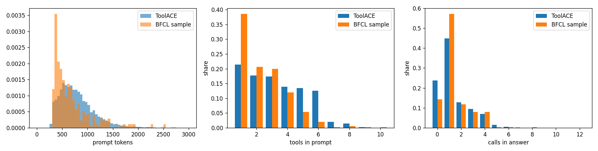
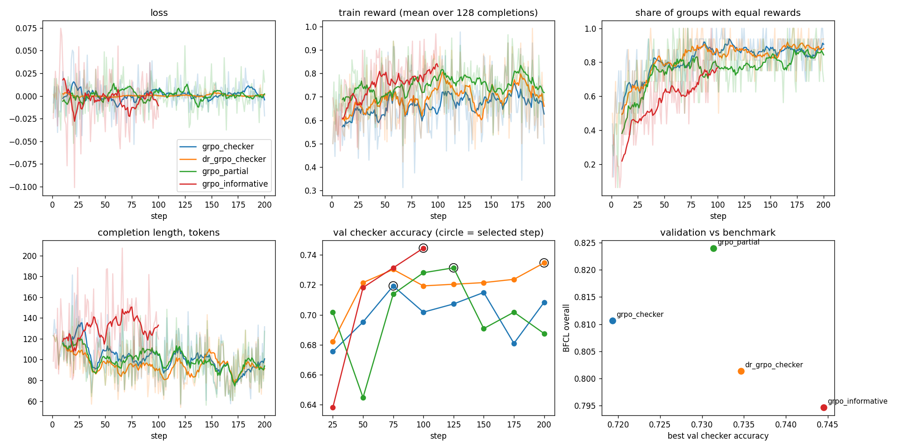

# GRPO на Qwen3.5-2B

Модель `Qwen/Qwen3.5-2B` дообучена только с помощью RL (GRPO из TRL, LoRA) на данных ToolACE. Качество меряется `evaluate.py` на 350 примерах BFCL. Исходная модель набирает overall 0.689, лучшая RL-конфигурация - 0.824.

## Окружение

- **GPU:** NVIDIA H100 80GB
- **Образ:** собран из `Dockerfile`: vLLM 0.22.0, TRL 1.16.0, transformers 5.9.0, peft 0.18.1, bfcl-eval 2026.3.23, torch 2.11.

## 1. Данные

### EDA

`Team-ACE/ToolACE` (ревизия `6bda777c`) - 11 300 синтетических диалогов. В системном промпте лежит список инструментов
в JSON, ответы ассистента - либо вызовы в виде `[Get Weather(city="Paris"), ...]`, либо обычный текст. Ответы
инструментов идут отдельными репликами.

- 10 500 диалогов содержат один ответ ассистента, остальные многоходовые (до 6 ответов).
- 735 диалогов используют другие форматы: инструменты описаны HTML-таблицей или вызов записан другим синтаксисом,
  часть на китайском. Их я не использую.
- В диалогах 16 131 уникальный инструмент, в одном промпте от 1 до 9 инструментов. В BFCL 1-10, чаще всего 1-3.
- Длина промпта после chat template: медиана 729 токенов, 99-й перцентиль 2 020. В BFCL медиана 538, 99-й перцентиль 2 087.
- Ответы короткие: медиана 41 токен (JSON вызовов), 99-й перцентиль 306.
- Вызовов в ответе: 0 - 24%, 1 - 45%, 2-4 - 29%, больше - 2%. В BFCL: 0 - 14%, 1 - 57%, 2-4 - 28%.



### Подготовка (`prepare_data.py`)

1. **Разворачивание диалогов.** Каждый ответ ассистента становится отдельным примером: промпт - вся история до него,
   эталон - список вызовов или пустой список, если ассистент ответил текстом. Предыдущие вызовы в истории записываются
   как `tool_calls`, ответы инструментов - как сообщения `tool`. Получилось 13 074 примера.
2. **Разбор вызовов.** Синтаксис похож на Python, но в именах функций есть пробелы, а аргументы бывают ключевыми словами
   (`from=...`). Имена функций и аргументов вне строковых литералов заменяются на заглушки, после чего строка
   разбирается `ast`.
3. **Чистка типов.** В схемах ToolACE тип `int` заменяется на `integer`, как в BFCL. Значения в эталоне приводятся к
   типу из схемы: `5.0` для integer становится `5`.
4. **Ground truth в формате BFCL.** Для каждого аргумента эталона список допустимых значений из одного значения.
   Если оно совпадает с default из схемы, добавляется `""`: аргумент можно пропустить. Необязательные аргументы, которых
   нет в эталоне, получают `["", default]`. Для параметров-словарей и списков словарей используется вложенный формат
   BFCL.
5. **Самопроверка.** Эталон должен проходить ту же проверку BFCL, что и ответы модели.
6. **Разбиение по диалогам.** 500 случайных диалогов идут в валидацию (604 примера), остальные в train
   (12 465 примеров).
7. **Категории.** По эталону каждому примеру присваивается категория BFCL. Нет вызовов - irrelevance. Один вызов -
   simple, если инструмент один, иначе multiple. Несколько вызовов - parallel, если инструмент один, иначе
   parallel_multiple.

Промпт собирается тем же вызовом, что и в `evaluate.py`: `tokenizer.apply_chat_template(messages, tools=..., enable_thinking=False)`, схемы инструментов проходят через `convert_bfcl_schema_to_json_schema`. Системный промпт ToolACE отбрасывается, т.к. в BFCL его нет, а шаблон Qwen сам добавляет инструкцию про инструменты.

В обучение идут только примеры, где ответ следует за сообщением пользователя, и только с промптом до 2 048 токенов.
Бенчмарк однораундовый, а текстовые ответы после результата инструмента ничему полезному не учат. Остаётся 11 080
промптов: multiple 3 840, parallel_multiple 3 128, irrelevance 1 944, simple 1 381, parallel 787. Для выбора шага
используются 300 примеров валидации.

Примеры из train:

| категория | инструменты | запрос | эталон |
|---|---|---|---|
| multiple | Popular Events, Ideal Weight Calculator, Get Channels by Country | Can you give me a list of popular sports events happening this weekend in English? | `Popular Events(locale="EN")` |
| parallel_multiple | Currency Exchange, Retrieve NFT Asset, Get Shopify Store Info | Can you help me get detailed information about four different Shopify stores? Their store IDs are store123, store456, store789, and store101. | четыре вызова `Get Shopify Store Info(store_id=...)` |
| irrelevance | find_nearest_park | Can you help me find the nearest park? | без вызова: не хватает обязательного аргумента, ассистент переспрашивает |

## 2. Функция награды (`reward.py`)

**Основная награда - проверка BFCL.** Ответ разбирается тем же `Qwen3CoderToolParser` и проверяется той же функцией
`parse_and_score_response` из `evaluate.py`:

$$R_{checker} = \mathbb{1}[\text{ответ проходит AST-проверку BFCL}]$$

Пустые, обрезанные и плохо размеченные ответы получают 0. Если вызов не нужен, награда равна 1 только за ответ без
вызова. Награда совпадает с правилом бенчмарка, поэтому между тем, что оптимизируется, и тем, что меряется, нет зазора.

**Частичная награда.** Для ответов, которые не прошли строгую проверку, но хотя бы правильно размечены, засчитывается
часть баллов:

$$R_{partial} = \begin{cases} 1, & \text{ответ проходит проверку BFCL} \\ 0, & \text{разметка сломана или ответ обрезан} \\ 0.5 \cdot \frac{\sum_k s(\hat c_k, c_k)}{\max(|\hat C|, |C|)}, & \text{иначе} \end{cases}$$

Вызовы модели жадно сопоставляются с эталонными. Для пары $s = 0$, если имена функций разные, иначе
$s = 0.5 + 0.5 \cdot \frac{\text{число совпавших аргументов}}{\text{число аргументов в объединении}}$. Строки сравниваются без
учёта регистра, числа - численно. Множитель 0.5 держит любой неточный ответ ниже точного.

Как работают обе награды (`python3 reward.py`, вызов `get_weather(city, unit="celsius")`):

| ответ модели | проверка BFCL | частичная |
|---|---|---|
| верный вызов `get_weather(city="Paris")` | 1.00 | 1.000 |
| лишний неверный необязательный аргумент `unit="fahrenheit"` | 0.00 | 0.375 |
| неверное имя функции | 0.00 | 0.000 |
| лишний второй вызов (London) | 0.00 | 0.250 |
| текст вместо вызова | 0.00 | 0.000 |
| незакрытый `<tool_call>` | 0.00 | 0.000 |
| без вызова, когда вызов не нужен | 1.00 | 1.000 |
| вызов, когда он не нужен | 0.00 | 0.000 |

Эталонные ответы всех 604 примеров валидации, отрендеренные chat template, получают 1.0 от обеих наград. Это проверка
того, что разбор и ground truth собраны правильно.

## 3. Обучение (`train.py`, `experiments.py`)

Общая конфигурация:

| параметр | значение |
|---|---|
| алгоритм | GRPO из TRL 1.16, генерация через vLLM в том же процессе (colocate) |
| адаптер | LoRA r = 32, alpha = 64, все линейные слои языковой части (attention, linear attention, MLP), 33.6M параметров (1.8%) |
| learning rate | 2e-5, константа после 10 шагов warmup, gradient clipping 1.0 |
| шаги | 200 (у `grpo_informative` 100), на шаг 16 промптов × 8 генераций = 128 ответов |
| генерация | temperature 1.0, до 512 новых токенов, reasoning выключен |
| KL, клиппинг | beta = 0, epsilon = 0.2, одно обновление на собранный батч |
| точность | bf16, gradient checkpointing, seed 42 |
| выбор шага | каждые 25 шагов точность проверки BFCL на 300 примерах валидации (1 ответ, temperature 1.0), берётся лучший шаг |
| экспорт | `export.py` вливает LoRA в веса, сохраняет полный чекпоинт и `evaluate.py` его оценивает |

Конфигурации и гипотезы:

| запуск | что меняется | гипотеза |
|---|---|---|
| `grpo_checker` | loss GRPO (усреднение по токенам внутри ответа), advantage делится на std группы, награда - проверка BFCL | прямая оптимизация правила бенчмарка исправит главные ошибки исходной модели: пропущенные и лишние вызовы |
| `dr_grpo_checker` | loss Dr. GRPO: без деления на std и на длину ответа | без нормировок обновления меньше смещены к коротким ответам и меньше шумят в почти решённых группах |
| `grpo_partial` | частичная награда вместо строгой | на трудных промптах, где все 8 ответов не проходят проверку, частичные баллы дадут сигнал там, где строгая награда даёт нули |
| `grpo_informative` | как `grpo_checker`, но только промпты средней сложности, 100 шагов | если убрать промпты, которые исходная модель решает всегда или не решает никогда, в каждом шаге будет больше групп с ненулевым advantage |

В TRL 1.16 по умолчанию `loss_type="dapo"`, поэтому тип loss задаётся явно.

**Отбор промптов для `grpo_informative` (`difficulty.py`).** Исходная модель отвечает 8 раз (temperature 1.0) на 4 000
случайных промптов train, ответы проверяются той же наградой. Треть промптов она решает всегда, пятую часть не решает
никогда, в GRPO у таких групп advantage нулевой с первого шага. Остаётся 1 809 промптов, их хватает на 100 шагов, это
примерно одна эпоха.

| категория | промптов | решает всегда | не решает никогда | средней сложности | средняя точность |
|---|---|---|---|---|---|
| multiple | 1 398 | 537 | 251 | 610 | 0.652 |
| simple | 486 | 186 | 100 | 200 | 0.631 |
| irrelevance | 720 | 200 | 95 | 425 | 0.598 |
| parallel | 293 | 96 | 75 | 122 | 0.573 |
| parallel_multiple | 1 103 | 294 | 357 | 452 | 0.491 |
| всего | 4 000 | 1 313 (33%) | 878 (22%) | 1 809 (45%) | 0.590 |

## 4. Результаты

| запуск | шаг | Overall | Simple | Multiple | Parallel | Parallel multiple | Irrelevance |
|---|---|---|---|---|---|---|---|
| исходная модель | - | 0.689 | 0.660 | 0.787 | 0.560 | 0.800 | 0.640 |
| `grpo_checker` | 75 | 0.811 | 0.840 | 0.813 | 0.780 | **0.880** | 0.740 |
| `dr_grpo_checker` | 200 | 0.801 | 0.840 | 0.827 | 0.660 | 0.860 | **0.820** |
| `grpo_partial` | 125 | **0.824** | 0.840 | **0.860** | 0.760 | 0.860 | 0.800 |
| `grpo_informative` | 100 | 0.795 | 0.780 | 0.793 | 0.720 | 0.860 | **0.820** |

Overall считается как в `evaluate.py`: среднее по пяти группам, а внутри multiple и irrelevance среднее по обычной и
live-части. `metrics.json` и `predictions.jsonl` каждого запуска лежат в `results/<запуск>/`, логи обучения и
конфигурации - в `runs/<запуск>/`.



Верхний ряд: loss, средняя награда на шаге, доля групп с одинаковыми наградами. Нижний ряд: длина ответа, точность на
валидации (кружком отмечен выбранный шаг) и лучшая точность на валидации против BFCL. У `grpo_partial` на втором
графике частичная награда, у `grpo_informative` награда считается на отобранных промптах средней сложности.

**Насколько различия значимы.** На одних и тех же 350 примерах посчитаны случаи, где права только одна модель
(z = (a − b) / √(a + b)):

| пара | права только первая | права только вторая | z |
|---|---|---|---|
| исходная vs `grpo_checker` | 15 | 48 | 4.16 |
| исходная vs `dr_grpo_checker` | 20 | 52 | 3.77 |
| исходная vs `grpo_partial` | 13 | 54 | 5.01 |
| `grpo_checker` vs `grpo_partial` | 10 | 18 | 1.51 |
| `grpo_checker` vs `dr_grpo_checker` | 16 | 15 | 0.18 |
| исходная vs `grpo_informative` | 24 | 51 | 3.12 |
| `grpo_partial` vs `grpo_informative` | 23 | 9 | 2.47 |

Все четыре RL-конфигурации заметно лучше исходной модели. Из различий между самими конфигурациями значимо только одно:
`grpo_informative` хуже `grpo_partial`. Остальные различия (до 2.3 п.п. overall) в пределах шума 350 примеров.

**Типы ошибок** (из 350):

| запуск | нет вызова | лишний вызов | значение строки | не найдено соответствие в parallel | неверное число вызовов | другое значение | пропущен необязательный | сломанная разметка |
|---|---|---|---|---|---|---|---|---|
| исходная модель | 33 | 15 | 14 | 10 | 5 | 7 | 4 | 5 |
| `grpo_checker` | 6 | 12 | 14 | 7 | 10 | 6 | 7 | 1 |
| `dr_grpo_checker` | 7 | 9 | 8 | 8 | 7 | 6 | 7 | 10 |
| `grpo_partial` | 6 | 10 | 10 | 11 | 9 | 5 | 5 | 0 |
| `grpo_informative` | 24 | 9 | 13 | 11 | 6 | 3 | 6 | 0 |

Полная таблица в [`results/table.md`](results/table.md).

**Что произошло при обучении.**

- **Модель перестала отвечать текстом там, где нужен вызов.** Таких ошибок было 33, в трёх запусках на полном train стало 6-7.
  На запрос «Find the Greatest Common Divisor (GCD) of two numbers, say 36 and 48» при доступной `number_theory.gcd`
  исходная модель сама расписывала алгоритм Евклида.
  Отсюда большой рост simple (+18 п.п.) и parallel.
- **Ответы стали короче:** 128 токенов в среднем у исходной модели против 85-90 у запусков на полном train. Модель перестала добавлять
  пояснения вокруг вызовов.
- **Сигнал быстро кончается.** В начале обучения в 60% групп все 8 ответов получают одинаковую награду, в конце - в
  88%. Энтропия падает с 0.36-0.39 до 0.15-0.24. Почти все промпты становятся либо всегда решёнными, либо всегда
  нерешёнными, и обучение выходит на плато к 75-125 шагу.
- **Отбор промптов увеличил сигнал, но научил не тому.** У `grpo_informative` одинаковые награды в начале получают
  34% групп, а не 60%. Награда на отобранных промптах растёт с 0.66 до 0.82, и точность на валидации лучшая из всех
  (0.745). Но на BFCL пропущенных вызовов снова 24 вместо 6, а ответы не короче, чем у исходной модели (129 токенов).
  Модель стала переспрашивать там, где BFCL ждёт вызов со значениями по умолчанию: «I need to know the cooking
  temperature... The default temperature is 180°C». В отобранных промптах больше irrelevance (24% против 18%). В
  основном это случаи, где исходная модель иногда вызывает функцию, а ToolACE требует переспросить. RL усилил именно
  эту конвенцию ToolACE.
- **Клиппинг не срабатывает.** При одном обновлении на батч отношение вероятностей равно 1, поэтому clip ratio всё
  время 0, и epsilon ни на что не влияет.

## 5. Ошибки лучшей модели (`grpo_partial`)

- **Лишний вызов (irrelevance).** «Find me restaurants in London» с инструментом `find_pois`: модель вызывает
  `find_pois(location="London", category=["Restaurants"])`. По разметке BFCL вызов не нужен, хотя инструмент выглядит
  подходящим, так что это скорее спорная разметка. «Identify the genetic code sequence "ATCG"» с
  `identify_species` - модель вызывает функцию определения вида, хотя её не просили.
- **Пропущенный вызов.** «Get me the top 10 landmark cases in constitutional law in China» с `get_top_cases`: модель
  отвечает, что инструмент ищет только по США. В описании аргумента `country` написано «Default is United States
  of America», и модель приняла значение по умолчанию за ограничение. На `simple_225` (опрос про цифровые и бумажные книги) исходная модель вызывала функцию, а дообученная
  отказывается. Это обратная сторона обучения на irrelevance-примерах ToolACE, где ассистент часто отказывает.
- **Значение аргумента.** `room_type="luxury room"` вместо `"luxury"`, `energy_type="renewable energy sources"` вместо
  `"renewable"`, `annual_interest_rate=3` вместо `0.03`. Модель копирует фразу из запроса, а BFCL ждёт нормализованное
  значение. Это крупнейший оставшийся класс ошибок, и ToolACE ему почти не учит: там значения обычно берутся из
  запроса дословно.
- **Неверное число вызовов.** В `parallel_104` нужно посчитать изменение энтропии для изотермического и
  неизотермического процесса, модель делает один вызов. В `multiple_26` она перебирает варианты миссий вместо одного
  вызова.
- **Пропущенный необязательный аргумент.** `dice_roll_probability(desired_sum=7, sides_per_die=6)` без `n_rolls=2`:
  BFCL требует аргумент, у которого в схеме нет default.

## 6. Ответы на вопросы

**1. Почему выбрали такую награду?** Метрика бенчмарка - бинарная AST-проверка. Поэтому основная награда - ровно эта проверка с тем же парсером. Награда не может разойтись с метрикой, и её невозможно взломать форматом, т.к. обрезанный или плохо размеченный ответ получает 0, как и на бенчмарке. Цена - разреженность; на трудных промптах все 8 ответов получают 0, и advantage равен нулю. Частичная награда добавлена, чтобы проверить, поможет ли более плотный сигнал. Множитель 0.5 гарантирует, что точный ответ всегда лучше любого частичного.

**2. Какое изменение сильнее всего повлияло на качество?** Само RL-обучение с наградой, совпадающей с метрикой: +11-13
п.п. overall, z от 3.1 до 5.0 против исходной модели. Из изменений между конфигурациями сильнее всего повлиял состав
данных, причём отрицательно: отбор промптов средней сложности снизил overall на 3 п.п. относительно `grpo_partial`
(z = 2.5), и это единственное значимое различие между RL-запусками. Тип loss и плотность награды сдвигают overall на
1-2 п.п., это в пределах шума (z ≤ 1.5). Отделить эффекты позволяет то, что конфигурации отличаются одним изменением
при одной модели, seed, гиперпараметрах и правиле выбора шага, и сравнение парное, на одних и тех же примерах.
Механизм виден по типам ошибок: у `grpo_informative` выросли пропущенные вызовы (с 6 до 24), остальные классы на
уровне других запусков. Кроме общего уровня, конфигурации меняют баланс категорий. Dr. GRPO лучше на irrelevance (0.82), но даёт 10 ответов со сломанной разметкой (7 из них в parallel) против 0-1 у GRPO. В GRPO advantage делится на std группы, поэтому редкая ошибка в почти решённой группе (7 из 8 верных) штрафуется сильнее,
(0 − 0.875) / 0.35 ≈ −2.5 против −0.875 в Dr. GRPO, и редкие сбои разметки вычищаются быстрее.

**3. Совпадает ли рост награды с ростом BFCL?** Только в начале. Награда на обучении растёт на протяжении всех 200
шагов: у `grpo_checker` с 0.60 до 0.67, у `dr_grpo_checker` с 0.62 до 0.70. Точность на валидации выходит на плато уже
к 50-75 шагу и дальше колеблется в пределах ±0.02. Это шум оценки - 300 примеров при temperature 1.0. Рост награды на
train после плато объясняется тем, что модель становится детерминированнее, доля групп с одинаковыми наградами растёт
до 0.88, а средняя награда при сэмплировании приближается к greedy-точности. Новые промпты модель при этом не учится
решать. Между запусками связь даже обратная (правый нижний график) - чем выше лучшая точность на валидации, тем ниже BFCL.
У `grpo_informative` она самая высокая (0.745), а BFCL самый низкий (0.795). У `dr_grpo_checker` точность 0.735, и он
ниже `grpo_checker` с его 0.719. Валидация и награда построены на ToolACE и наследуют его конвенции. Модель
переспрашивает, если не хватает аргумента, и копирует значения из запроса дословно. BFCL же ждёт вызов со значениями
по умолчанию и нормализованные строки. Пока RL чинит общие ошибки (отвечать вызовом, а не текстом), награда и BFCL
растут вместе. Дальше оптимизация конвенций ToolACE начинает мешать на BFCL. Поэтому выбирать шаг по валидации из
ToolACE - компромисс.

**4. Что происходит с advantage, если все ответы на запрос получают одинаковую награду?** Тогда
$R_{j,i} = \bar R_j$, и advantage равен нулю у всех ответов группы: $\hat A = 0 / (0 + \delta) = 0$ в GRPO и $0$ в
Dr. GRPO. Вклад каждого токена в градиент пропорционален advantage, поэтому группа не даёт обучающего сигнала, хотя на
её генерацию и прямой проход тратятся вычисления. В наших запусках к концу обучения таких групп 83-88%, то есть
полезный батч сжимается с 16 промптов до 2. DAPO решает это dynamic sampling (догенерировать
промпты, пока группы не станут информативными), но в TRL его нет. Частичная награда снижает долю таких групп в начале
обучения (47% против 60%), но к концу она тоже доходит до 83%. Отбор промптов (`grpo_informative`) - офлайн-аналог
dynamic sampling, в начале таких групп 34%, в конце 76%, то есть сигнала заметно больше. Но в нашем случае он
усилил поведение, которое BFCL штрафует.

**5. Какие ошибки остались у лучшей модели?** Больше всего ошибок в значениях аргументов
(10 строковых и 5 прочих), модель берёт формулировку из запроса вместо нормализованного значения. За ними идут
ошибки в составе и числе вызовов (11 несовпадений в parallel, 9 ошибок в числе вызовов), лишние вызовы на irrelevance (10) и пропущенные вызовы (6).

## Воспроизведение

```bash
export HF_HOME=/ephemeral/hf BFCL_PROJECT_ROOT=/ephemeral/bfcl
python3 prepare_data.py
python3 eda.py
python3 reward.py
python3 evaluate.py Qwen/Qwen3.5-2B --output results/base
python3 difficulty.py
python3 experiments.py
python3 make_report.py
```

- `prepare_data.py` скачивает ToolACE по зафиксированной ревизии, разворачивает диалоги, строит ground truth и делит
  данные по диалогам (seed 42). Результат в `data/train.jsonl` и `data/val.jsonl`.
- `eda.py` считает статистику для отчёта, `reward.py` запускает примеры наград с проверками.
- `difficulty.py` оценивает сложность 4 000 промптов исходной моделью для `grpo_informative` (`data/difficulty.jsonl`;
  в репозитории лежит сокращённая версия `data/difficulty_summary.json` без текстов промптов).
- `experiments.py` по очереди обучает конфигурации (`train.py`), выбирает шаг по валидации, вливает LoRA в веса
  (`export.py`) и запускает `evaluate.py`. Можно передать имена отдельных запусков.
- `make_report.py` строит таблицы и графики (нужен matplotlib, в образе его нет, поэтому запускался локально).

Ревизии модели и BFCL зафиксированы в `evaluate.py`, ревизия ToolACE - в `prepare_data.py`. Модели и чекпоинты в
репозиторий не входят.
