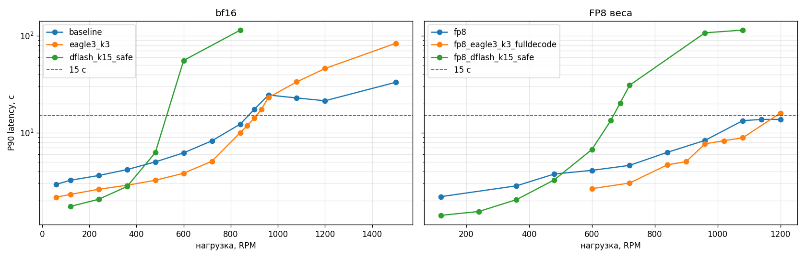
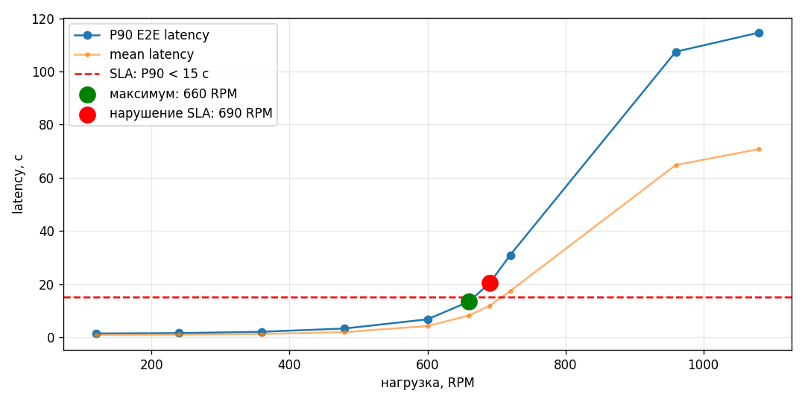

# Инференс Qwen3-8B, vLLM, спекулятивный декодинг, нагрузочное тестирование

Модель `Qwen/Qwen3-8B` (без reasoning, temperature 0, seed 42, до 512 токенов) поднимается через vLLM 0.22.0 и замеряется скриптами `benchmark.sh` и `load_test.sh` (AIPerf 0.13.0) на `data/requests.jsonl`.

Итог:
- **Лучшая конфигурация** - FP8-веса и спекулятивный декодинг DFlash (`fp8_dflash_k15_safe`): средняя задержка на 120 RPM 0.912 с против 2.418 с у бейзлайна, **S = 2.65**, P90 1.44 с против 3.15 с. Лучшая конфигурация, которая не меняет модель, - DFlash в bf16 (`dflash_k15_safe`), S = 2.15. EAGLE-3 в bf16 даёт S = 1.66.
- **Спекдек выигрывает только на малой и средней нагрузке.** EAGLE-3 быстрее бейзлайна до ~960 RPM, DFlash проверяет в 4 раза больше токенов и сдаётся раньше. Точки, где спекдек становится хуже в разделе 2.
- **Максимальная нагрузка лучшей конфигурации при P90 < 15 с - 660 RPM (11 RPS).** Это меньше, чем у бейзлайна (840 RPM), поскольку низкая задержка на малой нагрузке и потолок по нагрузке требуют разных конфигураций.

## Что где лежит

|  | файлы | объяснение |
|---|---|---|
| .sh-скрипты всех конфигураций | `configs/*.sh` (каждая - `serve.sh` с флагами) | раздел 1 |
| таблица конфигураций и метрик | `tables/1_latency_120rpm.md`, сырые замеры в `results/latency/` | раздел 1 |
| графики спекдека от нагрузки | `plots/spec_vs_load.png`, таблицы `tables/2_spec_*.md` | раздел 2 |
| график и таблицы нагрузочного теста, финальный RPM | `plots/load_test.png`, `tables/3_load_test_best.md`, `tables/3_max_rpm_by_config.md`, сырые замеры в `results/load/` | раздел 3 |
| скрипты для замеров | `benchmark.sh`, `load_test.sh` (из задания, без изменений), `run_bench.sh`, `worker.sh`, `queue.txt`, `collect.py` | «Методика и скрипты» |

## Окружение

- **GPU:** H200 141 GB
- **Образ:** `Dockerfile` (`vllm/vllm-openai:v0.22.0`). AIPerf 0.13.0 и transformers 5.22.1 стоят в отдельном venv, как в `Dockerfile`.
- **Кэш:** каждый замер запускает свежий сервер, а `benchmark.sh` и `load_test.sh` сами сбрасывают prefix cache. Кэш компиляции torch.compile у каждой конфигурации свой.

## Методика и скрипты

- `configs/<имя>.sh` - отдельный serve-скрипт на каждую конфигурацию
- `run_bench.sh <конфиг> latency` поднимает сервер конфигурации на своей карте (`GPU=0..3`, порт `8000 + GPU`), ждёт `/health` и запускает `benchmark.sh` (120 RPM, все 640 запросов). `run_bench.sh <конфиг> load <RPM> ...` вместо этого прогоняет `load_test.sh` для каждого RPM (300 с на точку).
- `worker.sh <gpu>` берёт задачи из `queue.txt` и выполняет их, четыре воркера работают параллельно. В `queue.txt` - полный список задач, которые дали результаты отчёта. `*_repeat.sh` - копии конфигураций для повторных замеров.
- `collect.py` собирает таблицы (`tables/`) и графики (`plots/`) из `results/` и логов серверов (`logs/*.server.log`).

Ускорение считается как S = mean latency бейзлайна / mean latency конфигурации. Сколько токенов
спекдек даёт за один проход целевой модели, взято из логов vLLM (`Mean acceptance length`).

## 1. Задержка на 120 RPM

Бейзлайн - дефолтный `vllm serve Qwen/Qwen3-8B` без флагов. В vLLM 0.22 по умолчанию уже включены torch.compile, CUDA graphs в режиме `FULL_AND_PIECEWISE`, chunked prefill (8 192 токена на шаг), prefix caching, асинхронное планирование и `gpu_memory_utilization` 0.9.

| конфигурация | mean, с | S | P50, с | P90, с | TTFT, мс | TTFT P90, мс | ITL, мс | токенов/с | принято за шаг | общий префикс с бейзлайном |
|---|---|---|---|---|---|---|---|---|---|---|
| `fp8_dflash_k15` | 0.892 | 2.71 | 0.925 | 1.411 | 39 | 78 | 2.05 | 839 | 2.79 | 12% |
| `fp8_dflash_k15_safe` | 0.912 | 2.65 | 0.947 | 1.442 | 38 | 77 | 2.10 | 839 | 2.79 | 12% |
| `fp8_dflash_k15_kvfp8` | 0.930 | 2.60 | 0.979 | 1.463 | 38 | 79 | 2.16 | 835 | 2.78 | 9% |
| `fp8_dflash_k7_safe` | 0.966 | 2.50 | 0.992 | 1.520 | 39 | 78 | 2.23 | 838 | 2.55 | 12% |
| `fp8_dflash_k11_safe` | 0.981 | 2.46 | 1.017 | 1.576 | 39 | 79 | 2.28 | 837 | 2.65 | 12% |
| `fp8_eagle3_k3_fulldecode` | 1.088 | 2.22 | 1.132 | 1.738 | 39 | 77 | 2.52 | 831 | 1.94 | 13% |
| `dflash_k15` | 1.106 | 2.19 | 1.160 | 1.744 | 47 | 104 | 2.55 | 835 | 2.80 | 39% |
| `dflash_k15_safe` | 1.123 | 2.15 | 1.180 | 1.770 | 49 | 107 | 2.60 | 834 | 2.81 | 39% |
| `eagle3_k4` | 1.452 | 1.67 | 1.487 | 2.331 | 46 | 101 | 3.38 | 834 | 2.02 | 39% |
| `eagle3_k5` | 1.453 | 1.66 | 1.481 | 2.378 | 47 | 105 | 3.37 | 834 | 2.05 | 39% |
| `eagle3_k3` | 1.456 | 1.66 | 1.494 | 2.332 | 46 | 103 | 3.38 | 836 | 1.95 | 40% |
| `eagle3_k2` | 1.484 | 1.63 | 1.566 | 2.271 | 44 | 101 | 3.46 | 833 | 1.82 | 39% |
| `fp8_eagle3_k3_piecewise` | 1.547 | 1.56 | 1.627 | 2.428 | 40 | 77 | 3.63 | 832 | 1.95 | 13% |
| `fp8` | 1.668 | 1.45 | 1.955 | 2.187 | 35 | 74 | 3.90 | 830 | - | 13% |
| `eagle3_angelslim` | 2.248 | 1.08 | 2.536 | 3.147 | 46 | 102 | 5.25 | 833 | 1.23 | 40% |
| `gpu_util_095` | 2.408 | 1.00 | 2.803 | 3.133 | 44 | 102 | 5.61 | 832 | - | 63% |
| `gpu_util_070` | 2.411 | 1.00 | 2.807 | 3.136 | 43 | 101 | 5.62 | 833 | - | 62% |
| `baseline` | 2.418 | 1.00 | 2.820 | 3.149 | 43 | 100 | 5.64 | 832 | - | 100% |
| `kv_fp8` | 2.428 | 1.00 | 2.840 | 3.161 | 43 | 99 | 5.69 | 830 | - | 13% |
| `batched_16k` | 2.429 | 1.00 | 2.833 | 3.156 | 44 | 99 | 5.65 | 834 | - | 63% |
| `eagle3_tengyunw` | 2.433 | 0.99 | 2.804 | 3.280 | 46 | 101 | 5.69 | 830 | 1.14 | 40% |
| `seqs_32` | 2.439 | 0.99 | 2.841 | 3.169 | 45 | 102 | 5.67 | 833 | - | 56% |
| `batched_2k` | 2.452 | 0.99 | 2.854 | 3.189 | 44 | 102 | 5.72 | 833 | - | 39% |
| `ngram` | 2.467 | 0.98 | 2.810 | 3.484 | 41 | 98 | 5.79 | 833 | 2.00 | 40% |
| `fp8_eagle3_k3_nocompile` | 4.357 | 0.55 | 4.567 | 6.994 | 65 | 85 | 10.36 | 823 | 1.95 | 13% |
| `eager` | 5.364 | 0.45 | 6.421 | 6.673 | 54 | 103 | 12.61 | 827 | - | 34% |

Последняя колонка - средняя доля ответа, совпадающая с ответом бейзлайна символ в символ.

**Из чего состоит задержка.** На 120 RPM в работе одновременно около 5 запросов. Время до первого токена - около 45 мс, средний ответ - 419 токенов по 5.6 мс. То есть 98% задержки - это декодинг. Каждый шаг декодинга читает из памяти все 16 ГБ весов ради 5 токенов, и GPU упирается в пропускную способность памяти, а не в вычисления. Отсюда оптимизации - читать меньше байт на шаг (квантизация) или получать больше токенов за одно чтение (спекулятивный декодинг).

**Параметры движка, которые не помогли.**
- **Размер чанка prefill** (`batched_2k`, `batched_16k`), **лимит последовательностей** (`seqs_32`) и **утилизация памяти** (`gpu_util_070`, `gpu_util_095`) меняют задержку в пределах 1-2%. Очереди нет, prefill занимает десятки миллисекунд, KV-кэш заполнен на 1-2%.
- **FP8 KV-кэш** (`kv_fp8`) тоже ничего не даёт, при 5 запросах с промптом около 1000 токенов KV-кэш читается в разы меньше, чем веса.
- **CUDA graphs.** `eager` (без графов) медленнее в 2.2 раза, так как каждый шаг запускает сотни ядер с CPU, ITL растёт с 5.6 до 12.6 мс. Бейзлайн и так работает в лучшем режиме графов.

**Что помогло.**
- **FP8-веса** (`fp8`, квантизация при загрузке): весов вдвое меньше, ITL падает с 5.6 до 3.9 мс, S = 1.45. Но это меняет модель, в среднем с бейзлайном совпадает 13% ответа, тогда как у конфигураций без потерь 34-63%.
- **EAGLE-3** (`eagle3_k*`, драфт `RedHatAI/Qwen3-8B-speculator.eagle3`): маленькая голова на скрытых состояниях Qwen3-8B предлагает k токенов, Qwen3-8B проверяет их за один проход. Первый предложенный токен принимается в 50% случаев, второй - в 30%, третий - в 16%, четвёртый - в 9%. В среднем проход даёт 1.95 токена, S = 1.66. k после 3 почти ничего не добавляет: дальние токены угадываются редко.
- **DFlash** (`dflash_k15*`, драфт `z-lab/Qwen3-8B-DFlash-b16`): блочный диффузионный драфтер предлагает сразу 15 токенов за один свой проход. Принимается в среднем 2.8 токена за проход Qwen3-8B против 1.95 у EAGLE-3, S = 2.19.
- **FP8 + DFlash** (`fp8_dflash_k15*`): выигрыши складываются - проход Qwen3-8B дешевле, а принимается по 2.8 токена. S = 2.71.

**Что не сработало.**
- **ngram-спекдек** не ускоряет: кандидаты берутся из промпта, а ответы в наших данных редко его копируют.
- **Другие драфты EAGLE-3** (`AngelSlim/Qwen3-8B_eagle3`, `Tengyunw/qwen3_8b_eagle3`) почти ничего не угадывают: первый токен принимается в 12-18% случаев против 50% у драфта RedHat.
- **FP8 + EAGLE-3** в vLLM 0.22 в режиме графов по умолчанию не запускается: при прогреве ядер индекс токена выходит за размер словаря (`index out of bounds: 0 <= tmp5 < 151936`). С `FULL_DECODE_ONLY` запускается и даёт S = 2.22, но только на свежем кэше компиляции, повторный старт с тем же кэшем падает с той же ошибкой.

**Другой движок.** SGLang не пробовал. Основной выигрыш здесь дают квантизация и спекдек, а они есть и в vLLM 0.22. На 120 RPM декодинг упирается в чтение весов, и смена движка мало что меняет, если не меняется драфтер.

**Почему у лучшей конфигурации суффикс `_safe`.** Под нагрузкой DFlash падал с CUDA OOM: при 485 запросах в батче проверка 16 токенов на запрос копирует логиты размером 485 × 16 × 151 936 во float32, это около 4 ГБ. vLLM не учитывает этот буфер, когда отдаёт память под KV-кэш. В `_safe` батч ограничен 256 запросами (`--max-num-seqs 256`), а под KV-кэш отдано 85% памяти вместо 90%. На 120 RPM это стоит около 2% (0.912 с против 0.892 с), зато сервер не падает. В нагрузочных тестах используется `_safe`.

**Почему ответы не совпадают с бейзлайном полностью.** Даже у конфигураций, которые не должны менять ответы (`batched_16k`, `seqs_32`, спекдек в bf16), в среднем совпадает 34-63% ответа. В bf16 результат матричного умножения зависит от размера батча, поэтому при жадном декодинге два прогона рано или поздно выбирают разные токены там, где у модели почти равные варианты. У FP8 ответы расходятся раньше (13%), потому что меняются сами веса.

## 2. Спекулятивный декодинг и нагрузка

Каждая точка - `load_test.sh` на 300 с. Слева конфигурации в bf16, справа - с FP8-весами.



**Бейзлайн и EAGLE-3:**

| RPM | P90 `baseline`, с | P90 `eagle3_k3`, с | P90 спекдек / без | mean `baseline`, с | mean `eagle3_k3`, с | выполнено RPM без / со спекдеком |
|---|---|---|---|---|---|---|
| 60 | 2.95 | 2.17 | 0.74 | 2.36 | 1.41 | 59 / 60 |
| 120 | 3.25 | 2.32 | 0.71 | 2.50 | 1.46 | 119 / 119 |
| 240 | 3.63 | 2.62 | 0.72 | 2.77 | 1.62 | 237 / 238 |
| 360 | 4.18 | 2.88 | 0.69 | 3.13 | 1.81 | 356 / 357 |
| 480 | 5.01 | 3.24 | 0.65 | 3.66 | 2.04 | 475 / 476 |
| 600 | 6.22 | 3.83 | 0.62 | 4.51 | 2.43 | 593 / 596 |
| 720 | 8.27 | 5.09 | 0.62 | 5.87 | 3.24 | 710 / 713 |
| 840 | 12.28 | 10.04 | 0.82 | 8.83 | 6.26 | 826 / 828 |
| 900 | 17.47 | 14.21 | 0.81 | 12.60 | 9.08 | 882 / 885 |
| 960 | 24.55 | 23.16 | 0.94 | 18.16 | 14.75 | 935 / 937 |
| 1080 | 22.88 | 33.50 | 1.46 | 17.24 | 21.44 | 1050 / 1041 |
| 1200 | 21.41 | 46.02 | 2.15 | 16.74 | 29.51 | 1165 / 1136 |
| 1500 | 33.18 | 83.76 | 2.52 | 26.28 | 56.68 | 1428 / 1207 |

**Бейзлайн и DFlash:**

| RPM | P90 `baseline`, с | P90 `dflash_k15_safe`, с | P90 спекдек / без | mean `baseline`, с | mean `dflash_k15_safe`, с | выполнено RPM без / со спекдеком |
|---|---|---|---|---|---|---|
| 120 | 3.25 | 1.74 | 0.54 | 2.50 | 1.11 | 119 / 120 |
| 240 | 3.63 | 2.07 | 0.57 | 2.77 | 1.28 | 237 / 239 |
| 360 | 4.18 | 2.80 | 0.67 | 3.13 | 1.66 | 356 / 358 |
| 480 | 5.01 | 6.25 | 1.25 | 3.66 | 3.76 | 475 / 475 |
| 600 | 6.22 | 55.71 | 8.95 | 4.51 | 33.74 | 593 / 530 |
| 840 | 12.28 | 114.44 | 9.32 | 8.83 | 72.88 | 826 / 431 |

**FP8 и FP8 + DFlash:**

| RPM | P90 `fp8`, с | P90 `fp8_dflash_k15_safe`, с | P90 спекдек / без | mean `fp8`, с | mean `fp8_dflash_k15_safe`, с | выполнено RPM без / со спекдеком |
|---|---|---|---|---|---|---|
| 120 | 2.20 | 1.41 | 0.64 | 1.69 | 0.89 | 119 / 120 |
| 360 | 2.84 | 2.05 | 0.72 | 2.11 | 1.21 | 358 / 359 |
| 480 | 3.76 | 3.27 | 0.87 | 2.84 | 1.93 | 476 / 477 |
| 600 | 4.10 | 6.74 | 1.64 | 3.06 | 4.21 | 595 / 595 |
| 720 | 4.62 | 30.93 | 6.70 | 3.39 | 17.40 | 714 / 689 |
| 960 | 8.36 | 107.44 | 12.86 | 6.04 | 64.80 | 949 / 701 |
| 1080 | 13.35 | 114.60 | 8.59 | 9.91 | 70.76 | 1060 / 601 |

На малой нагрузке GPU простаивает в ожидании памяти, проверить за один проход несколько токенов почти так же дёшево, как посчитать один, и спекдек ускоряет среднюю задержку в 1.7-2.2 раза. С ростом нагрузки батч растёт, и декодинг перестаёт упираться в память и начинает упираться в вычисления. Тогда каждый отвергнутый черновой токен - реальная потраченная работа. EAGLE-3 при k = 3 обрабатывает 4 токена на запрос, а принимает около 2, DFlash обрабатывает 16, а принимает около 3. Поэтому DFlash сдаётся раньше EAGLE-3, хотя на малой нагрузке он быстрее. Пропускная способность со спекдеком ниже - на 1500 RPM сервер с EAGLE-3 успевает отвечать на 1207 запросов в минуту, без него - на 1428.

**Где спекдек становится хуже бейзлайна.**

| пара | спекдек ещё лучше | спекдек уже хуже | точка перелома |
|---|---|---|---|
| EAGLE-3 против бейзлайна | 960 RPM: 23.2 против 24.6 с | 1 080 RPM: 33.5 против 22.9 с | около 1 000 RPM |
| DFlash против бейзлайна | 360 RPM: 2.8 против 4.2 с | 480 RPM: 6.3 против 5.0 с | около 400-450 RPM |
| FP8 + DFlash против FP8 | 480 RPM: 3.3 против 3.8 с | 600 RPM: 6.7 против 4.1 с | около 500-550 RPM |
| FP8 + EAGLE-3 против FP8 | 1 080 RPM: 8.9 против 13.4 с | 1 200 RPM: 16.0 против 13.7 с | около 1 100-1 200 RPM |

Чем больше токенов спекдек проверяет на запрос, тем раньше наступает точка перелома. EAGLE-3 проверяет 4 токена и держится до ~1 000 RPM, DFlash проверяет 16 и проигрывает уже с ~450 RPM, хотя на 120 RPM он быстрее. С FP8-весами проход целевой модели дешевле, поэтому FP8 + EAGLE-3 держится дольше, чем EAGLE-3 в bf16.

**Особенность замера.** У бейзлайна P90 после 960 RPM не растёт, а падает (24.6 -> 22.9 -> 21.4 с). Повтор на 960 RPM дал то же самое (24.0 с), так что это не шум. Причина - кэш префиксов: `load_test.sh` гоняет 640 запросов по кругу, и на высоком RPM одинаковые запросы приходят чаще, пока их блоки ещё в KV-кэше. На 960 RPM из кэша берётся 10% токенов промпта, на 1200 RPM - 53%. Prefill почти исчезает и меньше мешает декодингу.

## 3. Нагрузочное тестирование

Лучшая конфигурация из части 1 (`fp8_dflash_k15_safe`), каждая точка держится 300 с (`load_test.sh`), SLA: P90 E2E
< 15 с.



| RPM | P90, с | mean, с | P50, с | TTFT P90, мс | ITL, мс | выполнено RPM | из кэша префиксов | ошибки | P90 < 15 с |
|---|---|---|---|---|---|---|---|---|---|
| 120 | 1.41 | 0.89 | 0.93 | 79 | 2.04 | 120 | 1% | 0 | да |
| 240 | 1.55 | 0.98 | 1.00 | 80 | 2.24 | 239 | 1% | 0 | да |
| 360 | 2.05 | 1.21 | 1.25 | 83 | 2.81 | 359 | 1% | 0 | да |
| 480 | 3.27 | 1.93 | 1.90 | 96 | 4.53 | 477 | 1% | 0 | да |
| 600 | 6.74 | 4.21 | 4.35 | 137 | 10.01 | 595 | 1% | 1 | да |
| 660 | 13.36 | 8.13 | 8.30 | 227 | 19.45 | 649 | 1% | 0 | да |
| 690 | 20.31 | 11.83 | 11.67 | 313 | 28.32 | 671 | 1% | 0 | нет |
| 720 | 30.93 | 17.40 | 16.67 | 1496 | 41.09 | 689 | 4% | 0 | нет |
| 960 | 107.44 | 64.80 | 65.53 | 87038 | 49.83 | 701 | 7% | 40 | нет |
| 1080 | 114.60 | 70.76 | 72.34 | 104369 | 49.59 | 601 | 5% | 1230 | нет |

**Максимальная нагрузка - 660 RPM (11 RPS)**: P90 13.4 с. На 690 RPM P90 уже 20.3 с, на 720 RPM - 30.9 с, условие нарушено. До 480 RPM задержка почти не растёт (P90 около 3 с), дальше растёт очень быстро.

Для сравнения - максимальная нагрузка при P90 < 15 с у других конфигураций:

| конфигурация | максимум с P90 < 15 с | P90 на максимуме, с | первое нарушение | P90 там, с |
|---|---|---|---|---|
| `fp8_dflash_k15_safe` | 660 RPM | 13.36 | 690 RPM | 20.31 |
| `fp8_eagle3_k3_fulldecode` | 1080 RPM | 8.88 | 1200 RPM | 16.00 |
| `fp8` | 1200 RPM | 13.74 | - | - |
| `dflash_k15_safe` | 480 RPM | 6.25 | 600 RPM | 55.71 |
| `eagle3_k3` | 900 RPM | 14.21 | 930 RPM | 17.44 |
| `baseline` | 840 RPM | 12.28 | 900 RPM | 17.47 |

Чем сильнее спекдек ускоряет одиночный запрос, тем раньше конфигурация упирается в вычисления. Лучшая по задержке `fp8_dflash_k15_safe` держит 660 RPM, меньше бейзлайна. FP8 без спекдека держит больше 1 200 RPM: он не тратит вычисления на отвергнутые токены, а просто вдвое уменьшает объём весов. FP8 + EAGLE-3 оказывается компромиссом: S = 2.22 на 120 RPM и 1 080 RPM под SLA. Выбор зависит от цели. Если важна задержка при нагрузке до ~500 RPM, лучше FP8 + DFlash. Если нужен максимальный поток при P90 < 15 с, лучше FP8 без спекдека. Если нужно и то и другое, подходит FP8 + EAGLE-3, с поправкой на его нестабильный старт в vLLM 0.22.

## Воспроизведение

```bash
bash run_bench.sh baseline latency                          # одна конфигурация на 120 RPM
bash run_bench.sh fp8_dflash_k15_safe load 360 600 660 720  # нагрузочный тест
for gpu in 0 1 2 3; do bash worker.sh $gpu & done           # все задачи из queue.txt на 4 картах
python3 collect.py                                          # таблицы и графики
```

Перед запуском: `HF_HOME` с Qwen3-8B, драфты в `/ephemeral/models/` (пути в `configs/*eagle3*.sh` и `configs/*dflash*.sh`), AIPerf в `PATH`. Результаты лежат в `results/latency/<конфиг>/` и `results/load/<конфиг>/<RPM>/` (`profile_export_aiperf.json`, `profile_export_aiperf.csv`, `outputs.json` для части 1), логи серверов - в `logs/`.
