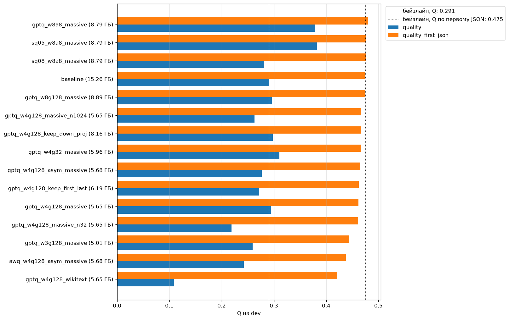
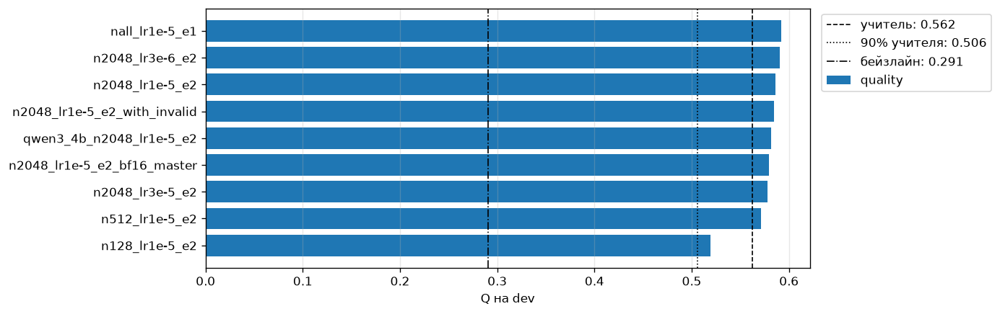

# Квантизация и дистилляция Qwen3 на MASSIVE ru-RU

Задача - разбор запросов к голосовому ассистенту из [MASSIVE](https://huggingface.co/datasets/AmazonScience/massive) (ru-RU): по запросу модель возвращает JSON с intent и slots. Бейзлайн - `Qwen/Qwen3-8B`, учитель - `Qwen/Qwen3-32B`. Качество Q = 0.5 * intent accuracy + 0.5 * slot micro F1 на всём dev (2032 записи). Весь код - в `homework_compression_student.ipynb`, ноутбук выполнен целиком сверху вниз.

Итог:
- **Квантизация.** Лучший компромисс - GPTQ W4 (group 128, калибровка на MASSIVE train): 5.65 ГБ вместо 15.26, Q 0.294 против 0.291 у бейзлайна. W8 и W8A8 (в том числе со SmoothQuant) проходят без потерь. Сильнее всего на качество влияет калибровочный датасет - с WikiText Q падает до 0.109, модель перестаёт выдавать валидный JSON.
- **Строгая Q бейзлайна почти целиком зависит от формата.** У 41% ответов бейзлайна JSON верный, но с лишней `}` в конце. Шум квантизации может как ломать, так и чинить эту ошибку, корреляция Q и доли валидного JSON по всем 15 запускам - 0.996. Поэтому влияние параметров квантизации оцениваем по дополнительной метрике - Q по первому JSON-объекту ответа.
- **Дистилляция.** Учитель набирает Q 0.562, порог 90% - 0.506. Ученик Qwen3-8B, дообученный на жадных ответах учителя (весь train, 1 эпоха), даёт Q 0.592 на dev (105% учителя) и 0.583 на test (107% учителя). 90% учителя достигается уже на 128 примерах (Q 0.520).

## Что где лежит

|  | файлы | раздел |
|---|---|---|
| ноутбук со всем кодом и выводами | `homework_compression_student.ipynb` |  |
| int4-checkpoint `gptq_w4g128_massive` с весами | [папка на Google Drive](https://drive.google.com/drive/folders/1jCVVKtTZceXIewnB6PMbFfVFXbhEC47l) (веса, конфиги, токенизатор, `README.md` с конфигом и метрикой, `dev_metrics.json`) | 2 |
| квантизованные Чекпоинты | `artifacts_compression_hw/quantized/<конфигурация>/` (конфиги, `recipe.yaml`, `quant_config.json`) | 2 |
| оценки на dev | `artifacts_compression_hw/eval/<модель>/metrics.json` и `predictions.jsonl`, сводки `baseline_dev.json`, `teacher_dev.json`, `student_dev.json` | 1-3 |
| таблицы | `artifacts_compression_hw/quantization_results.csv`, `distillation_results.csv`, `final_comparison.csv`, `all_results.csv` | 2, 3 |
| графики | `artifacts_compression_hw/plots/quantization.png`, `plots/distillation.png` | 2, 3 |
| ответы учителя | `artifacts_compression_hw/teacher_answers/answers.jsonl` | 3.2 |
| ученик и все эксперименты | `artifacts_compression_hw/student_sft/`, `artifacts_compression_hw/students/<запуск>/` (`distill_config.json`, `train_log.json`) | 3.4 |
| скрипты параллельного запуска | `runner.py`, `worker.sh`, `env.sh`, `queue.txt` | "Как считалось" |

Веса моделей (*.safetensors, всего 257 ГБ) в репозиторий не входят: в папках лежат конфиги, рецепты и логи обучения.

Сохранён один int4-checkpoint, [`gptq_w4g128_massive`](https://drive.google.com/drive/folders/1jCVVKtTZceXIewnB6PMbFfVFXbhEC47l) на Google Drive, 5.65 ГБ.

| параметр | значение |
|---|---|
| метод | GPTQ (llmcompressor 0.8.1, compressed-tensors 0.12.2) |
| веса | int4, симметрично, группы по 128 |
| активации | bf16 (W4A16) |
| в bf16 | только `lm_head` |
| калибровка | 256 примеров MASSIVE train в chat-формате, seed 42 |
| формат | `pack-quantized` |
| полный конфиг | `quant_config.json`, `recipe.yaml` |

На dev (2032 записи) у него Q 0.294, intent accuracy 0.377, slot F1 0.211, valid JSON 0.542. У бейзлайна Q 0.291.

## Окружение

- **GPU:** NVIDIA H200 141 GB.
- **Библиотеки**: torch 2.8.0, transformers 4.55.2, datasets 4.1.1, accelerate 1.10.1, llmcompressor 0.8.1, compressed-tensors 0.12.2, numpy 2.2.6, pandas 2.2.3 (`artifacts_compression_hw/environment.json`).

## Как считалось

Источник кода - ноутбук. Тяжёлые шаги (квантизация, оценка, ответы учителя, обучение ученика) кэшируются в `artifacts_compression_hw`. Если checkpoint или оценка уже есть на диске, ячейка читает их и не пересчитывает. Оценка кэшируется в `eval/<имя>/` и пересчитывается, если размер выборки не совпадает с сохранённым.

`runner.py <задача>` выполняет ячейки ноутбука с определениями и запускает одну задачу (`baseline`, `teacher`, `quant:<конфигурация>`, `distill:<запуск>`) на своей карте. `worker.sh <gpu>` берёт задачи из `queue.txt` по одной.

## 1. Бейзлайн

Qwen3-8B без reasoning (`enable_thinking=False`), greedy, до 128 новых токенов, Q 0.291, intent accuracy 0.372, slot F1 0.210, валидного JSON 53.5%.

Почти половина ответов невалидна, и это в основном одна ошибка: после правильного JSON модель дописывает лишнюю `}` (`...]]}}`), так 41% всех ответов. Строгая метрика считает такой ответ ошибкой целиком. Если брать из ответа первый JSON-объект и не смотреть на хвост (`quality_first_json` в ноутбуке), бейзлайн набирает 0.475.

## 2. Квантизация

Все конфигурации квантуют `Linear`-слои 36 блоков через llmcompressor (`oneshot`), `lm_head` и эмбеддинги остаются в bf16. Калибровка на MASSIVE - 256 диалогов из train в chat-формате (system prompt, запрос, эталонный JSON). Калибровка на WikiText - 256 случайных кусков WikiText-2 train той же средней длины, чтобы наборы отличались только содержимым. Чекпоинты оцениваются так же, как бейзлайн - загружаются с распаковкой весов в bf16 (`run_compressed=False`).

Колонки `Q по первому JSON` и `совпадает с bf16` (доля ответов, совпавших с ответами бейзлайна символ в символ) - дополнительные. В конфигурациях W8A8 веса квантуются по каналам, активации - в int8 динамически по токену.

| конфигурация | метод | бит | группа | sym | активации | калибровка | примеров | в bf16 | ГБ | Q | intent acc | slot F1 | exact | valid JSON | Q по первому JSON | совпадает с bf16 |
|---|---|---|---|---|---|---|---|---|---|---|---|---|---|---|---|---|
| `baseline` | dense | 16 | - | - | - | - | - | всё | 15.26 | 0.291 | 0.372 | 0.210 | 0.099 | 0.535 | 0.475 | 1.00 |
| `gptq_w4g128_massive` | GPTQ | 4 | 128 | да | bf16 | MASSIVE | 256 | lm_head | 5.65 | 0.294 | 0.377 | 0.211 | 0.100 | 0.542 | 0.462 | 0.61 |
| `gptq_w4g128_wikitext` | GPTQ | 4 | 128 | да | bf16 | WikiText | 256 | lm_head | 5.65 | 0.109 | 0.104 | 0.113 | 0.014 | 0.155 | 0.421 | 0.17 |
| `gptq_w4g128_massive_n32` | GPTQ | 4 | 128 | да | bf16 | MASSIVE | 32 | lm_head | 5.65 | 0.219 | 0.265 | 0.173 | 0.086 | 0.395 | 0.461 | 0.55 |
| `gptq_w4g128_massive_n1024` | GPTQ | 4 | 128 | да | bf16 | MASSIVE | 1024 | lm_head | 5.65 | 0.263 | 0.336 | 0.190 | 0.093 | 0.483 | 0.467 | 0.59 |
| `gptq_w4g32_massive` | GPTQ | 4 | 32 | да | bf16 | MASSIVE | 256 | lm_head | 5.96 | 0.311 | 0.406 | 0.216 | 0.103 | 0.572 | 0.466 | 0.57 |
| `gptq_w4g128_asym_massive` | GPTQ | 4 | 128 | нет | bf16 | MASSIVE | 256 | lm_head | 5.68 | 0.277 | 0.355 | 0.199 | 0.106 | 0.512 | 0.465 | 0.65 |
| `gptq_w8g128_massive` | GPTQ | 8 | 128 | да | bf16 | MASSIVE | 256 | lm_head | 8.89 | 0.296 | 0.380 | 0.212 | 0.101 | 0.540 | 0.475 | 0.90 |
| `gptq_w3g128_massive` | GPTQ | 3 | 128 | да | bf16 | MASSIVE | 256 | lm_head | 5.01 | 0.259 | 0.338 | 0.180 | 0.076 | 0.499 | 0.443 | 0.24 |
| `awq_w4g128_asym_massive` | AWQ | 4 | 128 | нет | bf16 | MASSIVE | 256 | lm_head | 5.68 | 0.242 | 0.290 | 0.194 | 0.083 | 0.454 | 0.438 | 0.37 |
| `gptq_w8a8_massive` | GPTQ | 8 | канал | да | int8 | MASSIVE | 256 | lm_head | 8.79 | 0.379 | 0.509 | 0.250 | 0.143 | 0.713 | 0.480 | 0.46 |
| `sq05_w8a8_massive` | SmoothQuant 0.5 + GPTQ | 8 | канал | да | int8 | MASSIVE | 256 | lm_head | 8.79 | 0.382 | 0.517 | 0.248 | 0.135 | 0.724 | 0.476 | 0.50 |
| `sq08_w8a8_massive` | SmoothQuant 0.8 + GPTQ | 8 | канал | да | int8 | MASSIVE | 256 | lm_head | 8.79 | 0.282 | 0.367 | 0.196 | 0.101 | 0.522 | 0.476 | 0.57 |
| `gptq_w4g128_keep_first_last` | GPTQ | 4 | 128 | да | bf16 | MASSIVE | 256 | lm_head, блоки 0 и 35 | 6.19 | 0.272 | 0.346 | 0.197 | 0.092 | 0.493 | 0.463 | 0.55 |
| `gptq_w4g128_keep_down_proj` | GPTQ | 4 | 128 | да | bf16 | MASSIVE | 256 | lm_head, все down_proj | 8.16 | 0.298 | 0.369 | 0.226 | 0.110 | 0.524 | 0.467 | 0.64 |



### 2.1. Калибровочный датасет

GPTQ W4 g128 на MASSIVE даёт Q 0.294, на WikiText - 0.109. По первому JSON - 0.462 против 0.421, совпадение с bf16 - 61% против 17%. GPTQ подбирает поправки весов под активации калибровочных данных. Английские статьи без chat-шаблона и system prompt дают другое распределение активаций, и модель теряет формат, валидного JSON 15.5%, в 28% ответов JSON вообще не разбирается. Кроме того, она хуже определяет intent - 0.56 против 0.66 по первому JSON. Калибровочный датасет влияет сильнее любого другого параметра.

### 2.2. Конфигурации

- **Битность.** W8 без потерь, GPTQ W8 g128 - 0.475, W8A8 - 0.480 по первому JSON. W4 теряет около 0.01 (0.461-0.467), W3 - 0.03 (0.443) и в 36% ответов ломает JSON.
- **Число калибровочных примеров.** На 32 примерах - 0.461, но валидного JSON всего 39.5%. На 256 и 1024 - 0.462 и 0.467, разницы нет.
- **Group size.** 32 против 128 - 0.466 против 0.462, в пределах шума, checkpoint больше на 0.3 ГБ.
- **Symmetric / asymmetric.** 0.462 против 0.465. Асимметричная сетка ближе к bf16, совпадение 65% против 61%, относительная ошибка весов `down_proj` 10-го блока 0.133 против 0.149.
- **AWQ** W4 asym - 0.438, хуже GPTQ с той же схемой (0.465).
- **SmoothQuant + W8A8.** С int8-активациями по токену потерь нет и без сглаживания (0.480), со smoothing_strength 0.5 и 0.8 - 0.476. Сглаживание приближает ответы к bf16 (совпадение 46% -> 50% -> 57%), то есть уменьшает ошибку квантизации активаций, но с динамической шкалой на каждый токен она и так мала. Строгая Q у W8A8 и `sq05` выше бейзлайна (0.38) только потому, что шум активаций реже приводит к лишней `}`. При 0.8 ответы ближе к bf16, и Q возвращается к уровню бейзлайна (0.282).
- **Слои в исходной точности (+1).** Все `down_proj` в bf16 (+2.5 ГБ) - 0.467, совпадение 64% против 61%, небольшой выигрыш. Первый и последний блок в bf16 (+0.5 ГБ) - 0.463, не помогает. На вход `down_proj` идут активации после SwiGLU с самыми большими выбросами, поэтому у этого слоя наибольшая ошибка квантизации.

### 2.3. Что значимо

По убыванию влияния:
1. калибровочные данные: -0.054 по первому JSON и развал формата;
2. битность: W8 без потерь, W4 -0.01, W3 -0.03;
3. метод: AWQ -0.037 против GPTQ -0.013;
4. слишком мало калибровочных примеров: на 32 валидность падает до 40%.

Group size, симметрия, smoothing_strength и оставленные в bf16 слои меняют качество в пределах шума (около ±0.01 на 2032 примерах).

## 3. Hard-label дистилляция

### 3.1. Учитель против бейзлайна

| модель | Q | intent acc | slot F1 | exact | valid JSON | Q по первому JSON |
|---|---|---|---|---|---|---|
| бейзлайн Qwen3-8B | 0.291 | 0.372 | 0.210 | 0.099 | 0.535 | 0.475 |
| учитель Qwen3-32B | 0.562 | 0.751 | 0.373 | 0.284 | 0.973 | 0.562 |

Учитель сильнее в 1.93 раза по Q. Большая часть разрыва - формат, невалидных ответов у учителя 2.7% против 46.5%. Но и по первому JSON он выше бейзлайна на 0.09. Слабое место обоих - slots, в 47% всех ответов учителя intent верный, а slots нет. Типичные ошибки - другой тип slot (`device_type` вместо `house_place`), лишние или склеенные slots, значение в начальной форме вместо формы из запроса ("петропавловская крепость" вместо "петропавловской крепости").

### 3.2. Ответы учителя

Жадные ответы учителя собраны на весь train - 11 514 запросов, батчами по 64 из промптов близкой длины. 11 512 ответов закончились eos. 2 обрезаны лимитом 128 токенов и отброшены, чтобы ученик не разучился останавливаться. Невалидных ответов 2.6%; по умолчанию они в обучение не идут.

Относительно gold ответы учителя на train дают Q 0.562, как на dev, ученик учится на шумных метках, полностью верный фрейм только у 27.5% из них. Эксперименты берут первые N ответов, train заранее перемешан с seed 42.

### 3.3. Обучение ученика

`TeacherAnswerDataset` склеивает `prompt_ids` и `answer_ids` учителя, метки промпта = -100, loss считается только на ответе. `train_student` - HF `Trainer`:
- полное дообучение всех 36 блоков, эмбеддинги и lm_head заморожены;
- веса и AdamW в fp32, вычисления в bf16 autocast;
- gradient checkpointing, батч 16 (4 x 4 шага накопления);
- cosine-расписание, warmup 5%.

Ученик сохраняется в bf16.

### 3.4. Эксперименты

| запуск | ученик | примеров | lr | эпох | веса | невалидные ответы учителя | train loss | обучение, мин | Q | intent acc | slot F1 | exact | valid JSON | доля от учителя |
|---|---|---|---|---|---|---|---|---|---|---|---|---|---|---|
| `nall_lr1e-5_e1` | Qwen3-8B | 11 219 | 1e-5 | 1 | fp32 | выброшены | 0.149 | 20.0 | **0.592** | 0.781 | 0.402 | 0.300 | 1.000 | 105% |
| `n2048_lr3e-6_e2` | Qwen3-8B | 2048 | 3e-6 | 2 | fp32 | выброшены | 0.130 | 7.3 | 0.591 | 0.779 | 0.402 | 0.306 | 0.997 | 105% |
| `n2048_lr1e-5_e2` | Qwen3-8B | 2048 | 1e-5 | 2 | fp32 | выброшены | 0.142 | 7.3 | 0.586 | 0.772 | 0.400 | 0.306 | 0.995 | 104% |
| `n2048_lr1e-5_e2_with_invalid` | Qwen3-8B | 2048 | 1e-5 | 2 | fp32 | оставлены | 0.148 | 7.3 | 0.584 | 0.768 | 0.401 | 0.308 | 0.982 | 104% |
| `qwen3_4b_n2048_lr1e-5_e2` | Qwen3-4B | 2048 | 1e-5 | 2 | fp32 | выброшены | 0.161 | 5.1 | 0.581 | 0.763 | 0.400 | 0.308 | 0.992 | 103% |
| `n2048_lr1e-5_e2_bf16_master` | Qwen3-8B | 2048 | 1e-5 | 2 | bf16 | выброшены | 0.146 | 5.9 | 0.580 | 0.769 | 0.391 | 0.293 | 0.993 | 103% |
| `n2048_lr3e-5_e2` | Qwen3-8B | 2048 | 3e-5 | 2 | fp32 | выброшены | 0.193 | 7.2 | 0.578 | 0.772 | 0.384 | 0.298 | 0.996 | 103% |
| `n512_lr1e-5_e2` | Qwen3-8B | 512 | 1e-5 | 2 | fp32 | выброшены | 0.177 | 1.8 | 0.572 | 0.745 | 0.398 | 0.285 | 0.986 | 102% |
| `n128_lr1e-5_e2` | Qwen3-8B | 128 | 1e-5 | 2 | fp32 | выброшены | 0.266 | 0.5 | 0.520 | 0.689 | 0.350 | 0.231 | 0.943 | 92% |



- **Число ответов учителя.** 128 - 0.520 (92% учителя, цель достигнута уже здесь), 512 - 0.572, 2048 - 0.586, весь train (11 219 валидных ответов, 1 эпоха) - 0.592. Основной прирост - до 512 примеров, ученику нужно выучить формат и то, как учитель размечает slots.
- **Learning rate** (2048 примеров, 2 эпохи). 3e-6 - 0.591, 1e-5 - 0.586, 3e-5 - 0.578. При 3e-5 выше и train loss 0.193 против 0.130.
- **Невалидные ответы учителя в обучении.** 0.584, валидного JSON 98.2% против 99.5%, ученик перенимает и ошибки формата.
- **Веса в bf16 вместо fp32.** 0.580 против 0.586, в пределах шума. Обновления меньше шага сетки bf16 теряются, но для этой задачи, где важен в основном формат, оставшихся хватает.
- **Ученик Qwen3-4B.** 0.581, вдвое меньшая модель почти не уступает 8B.

### 3.5. Итоговый ученик

Лучший по dev запуск `nall_lr1e-5_e1` скопирован в `student_sft`. Ученик выбран по dev, поэтому все три модели дополнительно оценены на всём test.

| выборка | модель | Q | intent acc | slot F1 | exact | valid JSON | Q по первому JSON | доля от учителя |
|---|---|---|---|---|---|---|---|---|
| dev (2032) | бейзлайн Qwen3-8B | 0.291 | 0.372 | 0.210 | 0.099 | 0.535 | 0.475 | 52% |
| dev (2032) | учитель Qwen3-32B | 0.562 | 0.751 | 0.373 | 0.284 | 0.973 | 0.562 | 100% |
| dev (2032) | ученик `student_sft` | **0.592** | 0.781 | 0.402 | 0.300 | 1.000 | 0.592 | **105%** |
| test (2974) | бейзлайн Qwen3-8B | 0.265 | 0.346 | 0.183 | 0.103 | 0.515 | 0.449 | 48% |
| test (2974) | учитель Qwen3-32B | 0.547 | 0.740 | 0.353 | 0.262 | 0.976 | 0.547 | 100% |
| test (2974) | ученик `student_sft` | **0.583** | 0.778 | 0.388 | 0.278 | 1.000 | 0.583 | **107%** |

Ученик обходит учителя. Он обучен только на валидных ответах и всегда выдаёт валидный JSON, 100% против 97.3%. Его intent accuracy 0.781 близка к точности учителя на его валидных ответах (0.751 / 0.973 = 0.772). Бейзлайн он опережает и по строгой Q (0.592 против 0.291), и по первому JSON (0.592 против 0.475), то есть дистилляция улучшила не только формат.

## Воспроизведение

```bash
pip install "torch==2.8.0" "transformers==4.55.2" "datasets==4.1.1" "accelerate==1.10.1" \
    "llmcompressor==0.8.1" "compressed-tensors==0.12.2" "numpy==2.2.6" "pandas==2.2.3" \
    "safetensors>=0.5" "huggingface-hub<1" tqdm matplotlib nbconvert ipykernel
for gpu in 0 1 2 3; do bash worker.sh $gpu & done
jupyter nbconvert --to notebook --execute --inplace homework_compression_student.ipynb
```
